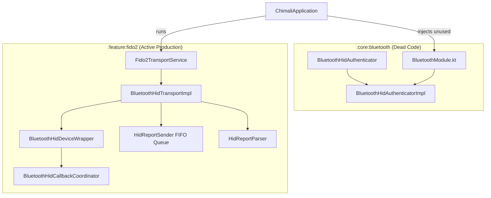
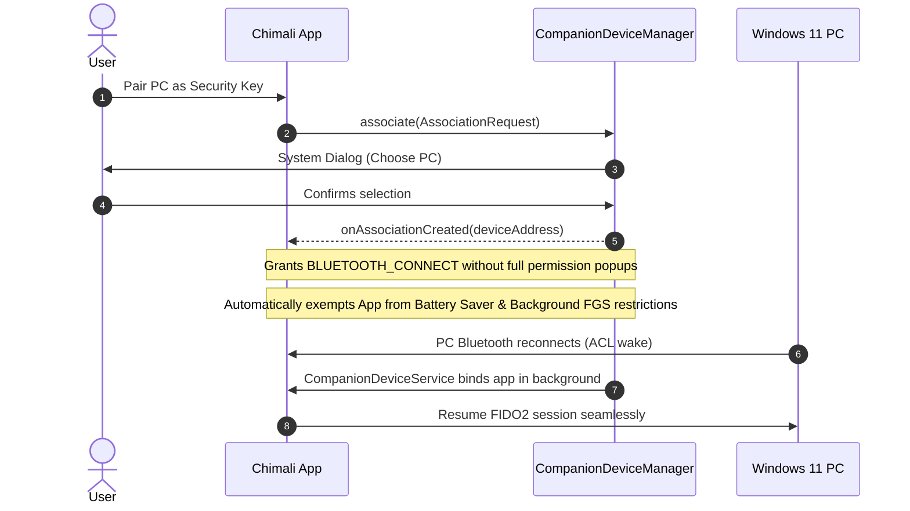
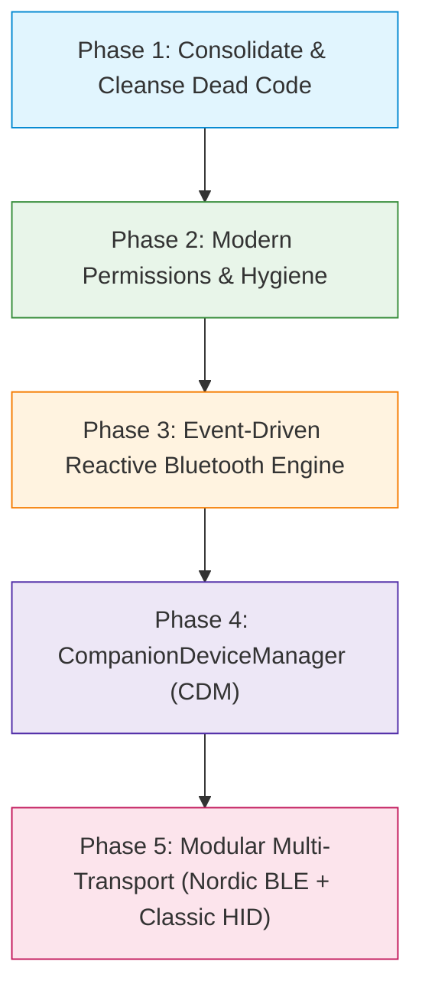

# Chimali Bluetooth Connectivity & Architecture Assessment

**Author:** Antigravity  
**Target Repository:** Chimali (`ofrenda` branch)  
**Date:** November 2026  
**Scope:** Core Bluetooth infrastructure (`:core:bluetooth`), FIDO2 HID transport (`:feature:fido2`), Nordic Semiconductor Kotlin-BLE-Library (v2.0), Android platform integration (Android 12–15+), CompanionDeviceManager, and cross-platform readiness.

---

## 1. Executive Summary

Chimali implements a virtual FIDO2/CTAP2 Authenticator capable of performing WebAuthn registration (`MakeCredential`) and authentication (`GetAssertion`) with host PCs (notably Windows 11). To achieve cross-platform hardware key emulation, Chimali currently employs **Classic Bluetooth Human Interface Device (HID) Peripheral mode** (`BluetoothProfile.HID_DEVICE`), allowing the Android phone to present itself as a physical FIDO composite security key via SDP records.

While the existing implementation in [`BluetoothHidDeviceWrapper`](../../feature/fido2/src/androidMain/kotlin/com/chimali/fido2/bluetooth/BluetoothHidDeviceWrapper.kt) and [`BluetoothHidTransportImpl`](../../feature/fido2/src/androidMain/kotlin/com/chimali/fido2/data/transport/BluetoothHidTransportImpl.kt) has achieved real-world compatibility through diligent reverse engineering of Windows 11 and OEM stack quirks (e.g., L2CAP 62-byte MTU limits, Motorola zombie state clearing, pacing queues), the codebase carries substantial architectural debt and diverges from modern Android best practices:

1. **Dual-Module Schism & Dead Code**: The project compiles two disconnected Bluetooth stacks: an orphaned, incomplete prototype in [`:core:bluetooth`](../../core/bluetooth/src/main/kotlin/com/chimali/core/bluetooth/impl/BluetoothHidAuthenticatorImpl.kt) and the actual production implementation in [`:feature:fido2`](../../feature/fido2/src/androidMain/kotlin/com/chimali/fido2/bluetooth).
2. **Hidden API Reflection**: [`BluetoothHidCallbackCoordinator`](../../feature/fido2/src/androidMain/kotlin/com/chimali/fido2/bluetooth/BluetoothHidCallbackCoordinator.kt) uses reflection to invoke the non-SDK `@hide` method `BluetoothDevice.isConnected()`, exposing the app to runtime failures and Google Play review flags under Android 14/15+ targetSdk policies.
3. **Over-Privileged Manifest & Outdated Permission Flow**: The manifest requests legacy `ACCESS_FINE_LOCATION` and `ACCESS_COARSE_LOCATION` despite using `BLUETOOTH_SCAN` with `neverForLocation`. Permission denial handling at runtime is passive without in-app recovery paths.
4. **Lack of CompanionDeviceManager (CDM)**: Android 12–15+ strongly advocates for CDM for PC/accessory pairing. Using CDM would exempt Chimali from broad permissions, eliminate reliance on indefinite foreground services, and enable OS-level presence detection.
5. **Single-Transport Monolith vs. Modern BLE (Nordic Kotlin-BLE-Library)**: Heavy reliance on Classic Bluetooth HID precludes iOS support ([`IosPlatformBluetoothHid`](../../feature/fido2/src/iosMain/kotlin/com/chimali/fido2/platform/IosPlatformBluetoothHid.kt) is an empty stub) because iOS restricts Classic HID peripheral emulation to MFi accessories. Modern BLE libraries—specifically **Nordic Semiconductor's Kotlin-BLE-Library (v2.0)**—provide coroutine-native GATT server implementations, automatic request/response queuing, and JVM mock testing capabilities that can power a clean, cross-platform FIDO BLE (`0xFFFD`) transport.

---

## 2. Current Architecture Deep-Dive

### 2.1 The Two Bluetooth Stacks (Architectural Fracture)

The project currently compiles two separate Bluetooth modules:



- **[`:core:bluetooth`](../../core/bluetooth)**: Contains [`BluetoothHidAuthenticatorImpl`](../../core/bluetooth/src/main/kotlin/com/chimali/core/bluetooth/impl/BluetoothHidAuthenticatorImpl.kt). It registers an SDP record, but `stop()` is commented out, `sendConfirmation()` is a stub, and no CTAPHID packet processing exists. It is wired into Koin in `ChimaliApplication.kt`, but **no component in the entire codebase ever calls `startAdvertising()` on it**.
- **[`:feature:fido2`](../../feature/fido2)**: Implements the real, production-grade Bluetooth stack through [`BluetoothHidDeviceWrapper`](../../feature/fido2/src/androidMain/kotlin/com/chimali/fido2/bluetooth/BluetoothHidDeviceWrapper.kt) and [`BluetoothHidTransportImpl`](../../feature/fido2/src/androidMain/kotlin/com/chimali/fido2/data/transport/BluetoothHidTransportImpl.kt).

> [!WARNING]
> Eagerly registering `:core:bluetooth`'s `BluetoothHidAuthenticatorImpl` requests `BluetoothProfile.HID_DEVICE` proxy simultaneously with `BluetoothHidDeviceWrapper`. On Android, `BluetoothHidDevice` only allows one active registration app across the entire OS. Retaining both risks resource contention and race conditions.

---

### 2.2 Production Transport Pipeline (`:feature:fido2`)

The active Bluetooth architecture consists of four tightly-coupled components:

1. **[`BluetoothHidDeviceWrapper`](../../feature/fido2/src/androidMain/kotlin/com/chimali/fido2/bluetooth/BluetoothHidDeviceWrapper.kt)**:
   - Manages the OS `BluetoothHidDevice` profile proxy and SDP registration (`SUBCLASS1_COMBO`).
   - Maintains connection lifecycle states via `StateFlow<HidConnectionState>` (`Idle`, `Advertising`, `Connecting`, `Connected`, `Error`).
   - Uses a session generation counter (`hidSessionGeneration`) with `sessionLock` to discard stale reports across reconnects.
   - Enqueues incoming reports into a Kotlin Coroutines `Channel<IncomingHidReport>(capacity = 64)`.
2. **[`BluetoothHidCallbackCoordinator`](../../feature/fido2/src/androidMain/kotlin/com/chimali/fido2/bluetooth/BluetoothHidCallbackCoordinator.kt)**:
   - Implements `BluetoothHidDevice.Callback` and registers dynamic `BroadcastReceiver` for `ACTION_STATE_CHANGED`, `ACTION_BOND_STATE_CHANGED`, and `ACTION_ACL_CONNECTED`.
   - Schedules proactive connections (`scheduleProactiveConnect`) to overcome Windows 11 ACL link dormancy.
3. **[`HidReportSender`](../../feature/fido2/src/androidMain/kotlin/com/chimali/fido2/data/transport/HidReportSender.kt)**:
   - Bounded outbound FIFO queue using Kotlin `Channel` and `Mutex`.
   - Enforces a 10 ms inter-report pacing delay (`reportPaceDelay`) to prevent overwhelming the Android HCI buffer during multi-packet responses.
4. **[`BluetoothHidConfigProvider`](../../feature/fido2/src/androidMain/kotlin/com/chimali/fido2/bluetooth/BluetoothHidConfigProvider.kt)**:
   - Externalizes tuning parameters (timeouts, retries, pacing) to accommodate OEM variances (Motorola, Asus).

---

## 3. Critical Findings & Technical Debt

### 3.1 Non-SDK Hidden API Usage: `BluetoothDevice.isConnected()`

In [`BluetoothHidCallbackCoordinator.kt`](../../feature/fido2/src/androidMain/kotlin/com/chimali/fido2/bluetooth/BluetoothHidCallbackCoordinator.kt):

```kotlin
private fun isAclConnected(device: BluetoothDevice): Boolean =
    try {
        val method = device.javaClass.getMethod("isConnected")
        (method.invoke(device) as? Boolean) ?: false
    } catch (e: SecurityException) { ... }
    catch (e: NoSuchMethodException) { ... }
```

- **Problem**: `BluetoothDevice.isConnected()` is a private/hidden method (`@hide`) in the Android SDK.
- **Risk**: Google enforces strict restrictions on non-SDK interfaces. In Android 14/15 (API 34/35), reflection on hidden APIs in the Bluetooth subsystem is restricted or logged as a policy violation. If OEM firmware alters this internal method signature, it fails silently, causing Chimali's proactive auto-connect feature to break.
- **Remediation**: Track ACL connection states deterministically through the public Android API via registered `ACTION_ACL_CONNECTED` and `ACTION_ACL_DISCONNECTED` broadcast events, or inspect `BluetoothProfile.getConnectionState(device)`.

---

### 3.2 Permission Model & Manifest Hygiene

In `app/src/main/AndroidManifest.xml` and `feature/fido2/src/androidMain/AndroidManifest.xml`:

```xml
<uses-permission android:name="android.permission.ACCESS_FINE_LOCATION" />
<uses-permission android:name="android.permission.ACCESS_COARSE_LOCATION" />
<uses-permission android:name="android.permission.BLUETOOTH_SCAN" 
    android:usesPermissionFlags="neverForLocation" />
```

- **Unnecessary Location Permissions**: Since Android 12 (API 31), specifying `android:usesPermissionFlags="neverForLocation"` on `BLUETOOTH_SCAN` explicitly asserts that the app does not derive physical location. Therefore, `ACCESS_FINE_LOCATION` and `ACCESS_COARSE_LOCATION` are redundant and trigger unnecessary privacy friction, user distrust, and Google Play Data Safety scrutiny.
- **Passive Startup Flow in `MainActivity`**: `MainActivity.kt` requests all Bluetooth permissions en-bloc at app launch. If the user denies them, the app logs a warning to logcat and does nothing. When the user later clicks "Start Authenticator", the service throws a `SecurityException`, ending in a generic error without an educational rationale dialog or settings intent link.
- **Deprecation in Intent Extra Parsing**: `BluetoothHidCallbackCoordinator.kt` uses `intent.getParcelableExtra<BluetoothDevice>(BluetoothDevice.EXTRA_DEVICE)`, which is deprecated since API 33. It should use `androidx.core.content.IntentCompat.getParcelableExtra`.

---

### 3.3 Polling Anti-Pattern in `BluetoothAdapterStateWaiter`

In `BluetoothAdapterStateWaiter.kt`:

```kotlin
while (state == BluetoothAdapter.STATE_TURNING_ON && waitAttempt < MAX_WAIT_ATTEMPTS) {
    delay(WAIT_DELAY) // 500ms polling loop
    state = readBluetoothState(...)
    waitAttempt++
}
```

- **Problem**: Polling the hardware state every 500 ms introduces artificial latency (up to 5 seconds) and burns CPU cycles.
- **Best Practice**: Convert `BluetoothAdapter.ACTION_STATE_CHANGED` into a reactive coroutine `callbackFlow`, allowing callers to suspend using `flow.first { it == BluetoothAdapter.STATE_ON }` with a clean timeout.

---

### 3.4 Foreground Service Lifecycle Risks on Android 14/15

In `Fido2TransportService.kt`:

```kotlin
override fun onStartCommand(...): Int {
    ...
    return START_STICKY
}
```

- **Problem**: In Android 14+ (targetSdk 34+) and Android 15 (targetSdk 35), starting a foreground service of type `connectedDevice` from the background is heavily restricted. If the system kills the app process and attempts a `START_STICKY` restart while in the background, calling `startForeground()` without an active system exemption throws `ForegroundServiceStartNotAllowedException` and crashes the app.
- **Industry Solution**: Utilize `CompanionDeviceManager` association or `WorkManager` with expedited job constraints for background reconciliation.

---

## 4. Modern Android Bluetooth Paradigms & Nordic Kotlin-BLE-Library

### 4.1 Evaluation of Nordic Semiconductor's `Kotlin-BLE-Library` (v2.0)

Nordic Semiconductor's [Kotlin-BLE-Library (v2.0)](https://github.com/nordicsemi/Kotlin-BLE-Library/tree/version/2.0) is the industry benchmark for modern, asynchronous Bluetooth Low Energy on Android. It replaces callback-heavy boilerplate with Kotlin Coroutines and Flows.

#### Architecture Comparison: Chimali vs. Nordic

```
+-----------------------------------------------------------------------------------+
|                                 CHIMALI ARCHITECTURE                              |
+-----------------------------------------------------------------------------------+
|  Protocol Layer   :  FIDO2 / CTAP2 (MakeCredential, GetAssertion, GetInfo)        |
|  Current Transport:  Classic Bluetooth HID (BluetoothHidDevice / L2CAP)          |
|  Queue Engine     :  Custom HidReportSender (Channel + Mutex + 10ms pacing delay)  |
|  Testing Engine   :  Mockk-heavy unit tests & real hardware logcat analysis       |
+-----------------------------------------------------------------------------------+

+-----------------------------------------------------------------------------------+
|                       NORDIC KOTLIN-BLE-LIBRARY (v2.0) CAPABILITIES               |
+-----------------------------------------------------------------------------------+
|  Target Protocol  :  Bluetooth Low Energy (BLE GATT: Server & Client)             |
|  Coroutine Support:  Flow-based, structured concurrency, StateFlow discovery       |
|  Queuing Engine   :  Built-in transparent queuing & dispatch of GATT operations   |
|  Testing Engine   :  Native 'mock' module allowing JVM GATT simulation without OS |
+-----------------------------------------------------------------------------------+
```

#### Key Findings Regarding Nordic's Library in Chimali:

1. **Applicability to Current Classic HID Stack**:
   - Nordic's library is strictly a **Bluetooth Low Energy (GATT)** library (`BluetoothGattServer` / `BluetoothGatt`).
   - It **does not** wrap Classic Bluetooth HID (`BluetoothProfile.HID_DEVICE`), because Classic HID runs directly over L2CAP control/interrupt sockets and SDP records, not GATT services.
   - Therefore, Nordic's library cannot directly replace `BluetoothHidDeviceWrapper` for Classic HID.

2. **Analysis of Nordic's `AndroidEnvironment` Note on HID (KitKat / HOGP)**:
   - In Nordic's `AndroidEnvironment.kt`, the following comment appears under `KITKAT = 19`:
     ```kotlin
     /**
      * Android 4.4.
      * New features:
      * * Added support for HID (Human Interface Device, aka Keyboard, Mouse, etc.) service.
      *
      * Note: An attempt to read or write an attribute belonging to the HID service will result
      *       in an exception.
      */
     ```
   - **What this actually means**: This note describes Android acting as a **BLE Central (Client)** connecting to external BLE input peripherals (keyboards, mice) implementing the standard BLE *HID Over GATT Profile* (HOGP, GATT Service `0x1812`). Starting with Android 4.4/5.0, Android's input subsystem claims exclusive ownership of `0x1812` to route input events into `/dev/input`. Third-party user-space apps attempting to directly read or write attributes of the `0x1812` HID service are blocked by the OS with a `SecurityException` (requiring signature-only `BLUETOOTH_PRIVILEGED` permission) to prevent malicious keylogger apps.
   - **Why this does not block Chimali**:
     - *Role difference*: Chimali acts as an **Authenticator Peripheral (Server)**, not an HID Client connecting to a keyboard.
     - *Classic HID*: Chimali's current stack uses Android 9's `BluetoothHidDevice` peripheral API, which operates over Classic Bluetooth L2CAP sockets rather than GATT `0x1812`.
     - *BLE FIDO Service (`0xFFFD`)*: Over BLE, the FIDO Alliance standard intentionally avoids HOGP `0x1812` and instead specifies the dedicated **FIDO BLE GATT Service (`0xFFFD`)**. This is a standard, unprivileged custom GATT service (`FIDO_CONTROL_POINT`, `FIDO_STATUS`) that is completely unencumbered by the Android OS `0x1812` input restriction and fully supported by Nordic's `server` module (`BleGattServer`).

3. **Crucial Role for FIDO BLE (`0xFFFD`) Transport**:
   - The FIDO Alliance defines two primary Bluetooth transports:
     1. **FIDO HID** (Classic Bluetooth HID or BLE HOGP).
     2. **FIDO BLE** (GATT Service UUID `0xFFFD` with `FIDO_CONTROL_POINT` and `FIDO_STATUS` characteristics).
   - For implementing FIDO BLE GATT, Nordic's `server` module (`no.nordicsemi.android.kotlin.ble:server`) is the ideal foundation. It provides:
     - Declarative GATT Service definition (`BleGattServer`).
     - Automatic operation queuing, completely eliminating the packet-dropping issues described in the Punch Through BLE guide without hand-rolling pacing delays.
     - Coroutine-driven characteristic write handling and notifications.

4. **Eliminating Testing Friction with Nordic's `mock` Module**:
   - Currently, testing Bluetooth in Chimali requires either brittle `mockk` mocking of Android framework proxies or testing on physical Android devices.
   - Nordic's `mock` module (`no.nordicsemi.android.kotlin.ble:mock`) enables simulating complete client-server BLE conversations on the JVM, allowing 100% automated CI tests for FIDO BLE registration and assertion flows.

---

### 4.2 Integration with `CompanionDeviceManager` (CDM)

Google designed `CompanionDeviceManager` (CDM) specifically for companion applications (smartwatches, health sensors, PC security keys). 



**Key Advantages for Chimali:**
1. **Elimination of "Zombie" Reconnections**: The system manages the bonded companion lifecycle.
2. **Background Wakeup**: `CompanionDeviceService` automatically wakes the app when the companion device is nearby or connected, eliminating the need to keep `Fido2TransportService` running 24/7 in the foreground.
3. **Data Safety / Play Store Compliance**: Removes the need for coarse/fine location and broad Bluetooth scanning permissions.

---

### 4.3 Multi-Transport Strategy: Classic HID vs. FIDO BLE (GATT)

| Dimension | Classic Bluetooth HID (Current) | FIDO BLE GATT (`0xFFFD`) (Recommended) |
| :--- | :--- | :--- |
| **Android Profile API** | `BluetoothHidDevice` (API 28+) | `BluetoothGattServer` / Nordic `server` |
| **Android OEM Stability** | High fragmentation (Motorola socket lockup, Asus proxy dropouts) | High stability (Standard BLE GATT across all vendors) |
| **iOS Compatibility** | **Unsupported** (iOS bans Classic HID peripheral role) | **Supported** via `CoreBluetooth.CBPeripheralManager` |
| **Windows 11 Support** | Supported (CTAPHID over L2CAP) | Supported (Standard FIDO2 BLE GATT) |
| **macOS / Linux Support** | Quirky HID enumeration | Standard WebAuthn BLE pairing |
| **MTU Handling** | Fixed 62-byte report size | Dynamic MTU negotiation via GATT |
| **Power Consumption** | Higher (continuous Classic link) | Ultra-low (standard BLE advertising) |

> [!IMPORTANT]
> To support iOS in Kotlin Multiplatform and expand beyond Android OEM quirks, Chimali must decouple the FIDO2 transport layer into a pluggable abstraction supporting both **Classic HID** (for Windows legacy setups) and **FIDO BLE GATT** (via Nordic's library on Android and `CoreBluetooth` on iOS).

---

## 5. Architectural Improvement Roadmap

The following five-phase plan details the recommended refactoring path:



### Phase 1: Consolidate & Eliminate Dead Code
- **Action**: Deprecate and remove the redundant [`:core:bluetooth`](../../core/bluetooth) implementation, or migrate the low-level Android `BluetoothHidDeviceWrapper` into `:core:bluetooth` as a domain-agnostic Bluetooth HID service.
- Remove `single<BluetoothHidAuthenticator>` from `BluetoothModule.kt` to avoid double proxy acquisition.

### Phase 2: Eliminate Hidden APIs & Clean Permissions
- **Action**: Replace `BluetoothDevice.isConnected()` reflection with public broadcast monitoring (`ACTION_ACL_CONNECTED` / `ACTION_ACL_DISCONNECTED`).
- Remove `ACCESS_FINE_LOCATION` and `ACCESS_COARSE_LOCATION` from both Android manifests.
- Update deprecated `intent.getParcelableExtra` to `IntentCompat.getParcelableExtra`.
- Implement a Compose-based permission educational rationale dialog in `Fido2HomeScreen.kt`.

### Phase 3: Event-Driven Reactive Bluetooth Engine
- **Action**: Replace `BluetoothAdapterStateWaiter.kt` polling with a `callbackFlow` observing `BluetoothAdapter.ACTION_STATE_CHANGED`.
- Encapsulate connection states into a formal Unidirectional Data Flow (UDF) state machine.

### Phase 4: CompanionDeviceManager (CDM) Integration
- **Action**: Introduce a CDM pairing flow for Windows PCs.
- Implement `CompanionDeviceService` to handle background reconnects without triggering Android 14/15 `ForegroundServiceStartNotAllowedException`.

### Phase 5: Modular Transport Abstraction & Nordic BLE Library Integration
- **Action**: Refactor `Fido2Transport.kt` into an extensible interface with two concrete implementations:
  1. `ClassicBluetoothHidTransport`: Existing, hardened HID transport for Windows.
  2. `BleGattTransport`: Built using Nordic's `Kotlin-BLE-Library` (`server` module) on Android and `CoreBluetooth` on iOS, implementing FIDO Service `0xFFFD`.
- Leverage Nordic's `mock` module to establish fast JVM-based automated integration testing for FIDO ceremonies without physical Bluetooth radios.

---

## 6. Conclusion

Chimali's current Bluetooth implementation is an impressive engineering accomplishment in overcoming proprietary OS quirks (Windows 11 L2CAP MTU limits, Motorola baseband zombies, and U2F registration probing). However, consolidating the dual modules, eliminating hidden reflection APIs, modernizing permissions, and leveraging Nordic Semiconductor's `Kotlin-BLE-Library` for FIDO BLE GATT will transition Chimali from a brittle OEM-specific workaround into a robust, compliant, cross-platform security key.
