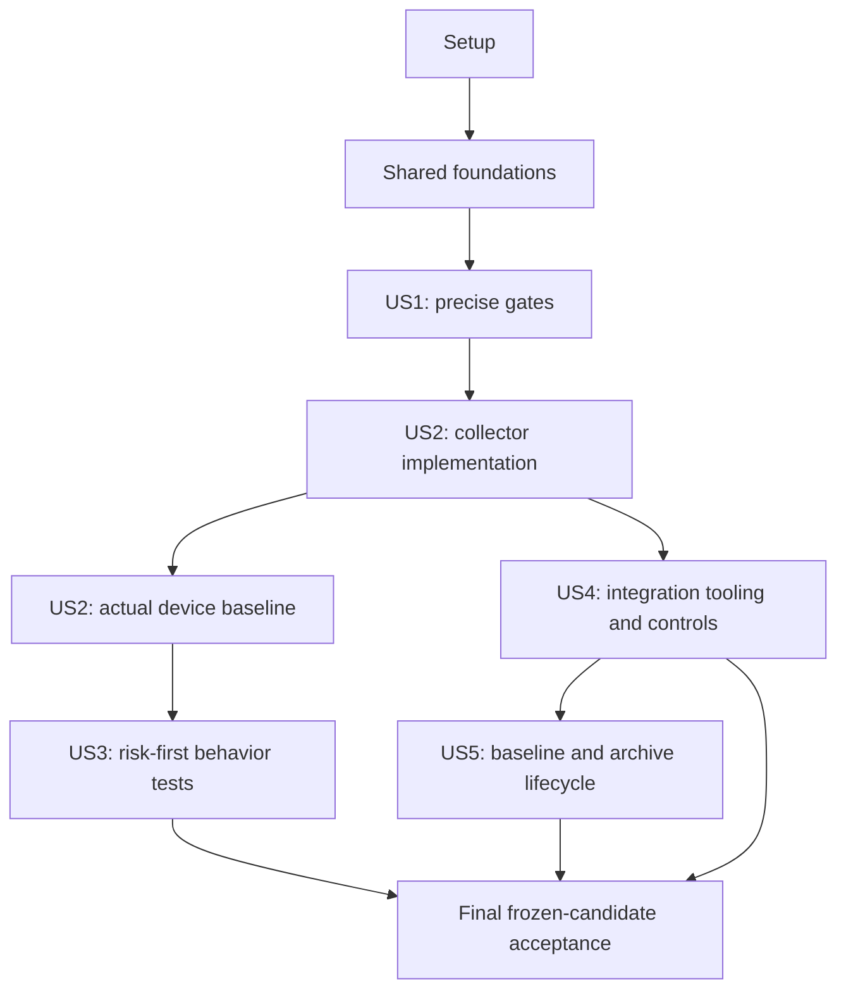

# Tasks: Enforce Coverage Targets

**Input**: Design documents from `specs/058-enforce-coverage-targets/`  
**Prerequisites**: [plan.md](plan.md), [spec.md](spec.md), [research.md](research.md), [data-model.md](data-model.md), [workflow contract](contracts/coverage-workflow.md), [validation guide](quickstart.md)  
**Created**: 2026-10-24  
**Status**: Local implementation complete (2026-10-27); T088, T104, T105, T107, and T108 local acceptance are verified complete. T088 is supported by clean Initial run `83ccf4f6-e85c-4db4-8476-1ee0b349c284` on commit `fa93a40cf34f6e130f7e4c79a4b55886d9afe9f2`. The owner waived T046–T049 because no acceptable disposable Windows/device worker is available and exposing the persistent Windows host and attached Android device to candidate PR code is unacceptable. These tasks are waived, not verified complete. The runner is disabled with its registration retained; re-enabling requires explicit owner authorization. T089 repeats the waived operational scope. Hosted acceptance remains unverified and excluded by the documented exception below; no local coverage floor or regression control was waived.

**Tests**: Explicitly required by this feature. Write decision/contract fixtures before implementing the missing tooling, verify that the missing behavior is detected, then make them pass. Behavioral coverage additions target existing production behavior and may pass without a production change; assert independent expected outcomes and named failure conditions rather than introducing artificial defects to obtain a failing test.

**Organization**: Setup and shared foundations first, then story phases in priority order: US1 (P1), US2 (P1), US4 (P1), US3 (P2), US5 (P2), then cross-cutting acceptance. Dependencies below distinguish implementation readiness from external runtime acceptance; no story is declared compliant merely because its files exist.

## Owner waiver: T046–T049 (2026-10-26)

The owner explicitly waived all four operational tasks after rejecting the exposure of a persistent Windows host and attached Android device to malicious PR code. There is no spare physical hardware or acceptable disposable Windows worker and disposable Android physical/virtual device; the investigated Windows Sandbox/Hyper-V approaches did not provide a usable environment on the available hardware. The runner remains disabled and registered. This replaces the earlier waiver of only runner disposability.

An unchecked task labelled **WAIVED** is administratively excluded from current execution; it is not a passing implementation or verification result. Retain the original task requirements and partial provisioning evidence in `implementation-evidence.md` §§11.20–11.28. T089 repeats T046–T049, so its operational work is covered by the same exception rather than queued again. The hosted-control/archive/integration demonstrations in T108 are likewise excluded; its local checks, exact coverage measurements, comparison, evidence preservation, and final documentation are complete (§11.44). No hard floor, required local suite, inventory/zero-proof rule, or local regression check is waived.

Existing GitHub App, environment, and archive ruleset settings are partial historical provisioning, not proof of hosted acceptance. Following the owner's separate explicit instructions, active default-branch ruleset `25926101` no longer requires `coverage-integration`; its pull-request, deletion, and force-push protections remain, with only user `octaviordz` added in `Always allow` bypass mode. This exception removes the coverage gate; it does not turn any unverified coverage result into success. See evidence §11.29.

## Format: `[ID] [P?] [Story] Description`

- Every task has an unchecked checkbox, sequential ID, explicit output/edit paths and a story label within story phases.
- `[P]` means separate files and no dependency on another unfinished task in the stated parallel group. It authorizes concurrent task execution only after that group's prerequisites; it does not change the approved behavior-test risk order.
- Paths are relative to the repository root unless explicitly identified as archive paths. Run directories and external settings are recorded through the named scripts/evidence files; do not fabricate an actual run ID, device identity, remote authorization or completed result.
- Existing threshold/module-list edits are unverified starting work. Preserve existing staged/unstaged user changes, assess them against these tasks, and check an item only after its stated implementation or verification outcome is supported.
- Hard floors: Tier 1 instruction/branch **60%/60%** where applicable, repository instructions **50%**, existing affected Tier 2 instructions **20%**. Approximately **65%** branches is a reported improvement goal. Risk priority applies across all Tier 1 modules before coverage-deficit ordering.
- No new Gradle module, coverage engine upgrade, blanket generated-code exclusion, artificial authenticator implementation, or weakening of BRD's separate 100% core-business-logic objective is authorized.
- T046–T049 are WAIVED under the owner decision above. Keep their checkboxes unchecked and their verification outcomes unverified; skip the waived operational work when choosing the next executable task.

## Phase 1: Setup — Confirm Scope and Prepare the Work

**Purpose**: Establish the current state and the inputs needed for later real verification without treating unavailable prerequisites as passes.

- [X] T001 Record the current branch/revision, staged and unstaged starting changes, existing task entry points and inherited limitations in `specs/058-enforce-coverage-targets/implementation-evidence.md`; distinguish the already edited 60/50 thresholds from unverified discovery, device, comparison and remote-enforcement work.
- [X] T002 Inventory PowerShell 7, Git, repository-compatible JDK/SDK, authorized device capability, actual integration target, GitHub access, protection support and runner/archive prerequisites in `specs/058-enforce-coverage-targets/implementation-evidence.md`; verify live settings when authorized access exists, and leave absent access/provisioning explicitly unmet rather than assuming `main` or the cached `origin/HEAD`.
- [X] T003 Create the planned verification-tool/fixture directories and document fixture ownership and synthetic-data restrictions in `tools/coverage/fixtures/README.md`; retain Gradle 9.6.0, AGP 9.4.1, Kotlin 2.3.21/JVM 17 and JaCoCo 0.8.15 without adding Pester or a new build module.
- [X] T004 Reconcile implemented/planned command shapes, canonical zero-count proof, the split capture/reporter workflows, dedicated App source binding and artifact locations against `specs/058-enforce-coverage-targets/contracts/coverage-workflow.md`, `specs/058-enforce-coverage-targets/data-model.md` and `specs/058-enforce-coverage-targets/plan.md`; keep `tools/coverage/publish.ps1` and `tools/coverage/report.ps1` focused internal helpers with no new product API or acceptance bypass.

## Phase 2: Foundational — Governance and Shared Evidence Rules

**Purpose**: Resolve the governing policy and shared record-validation boundaries before story implementations depend on them.

- [X] T005 Adopt the user-authorized Principle V amendment in `.specify/memory/constitution.md` by changing only the percentages in the existing concise Execution Determinism & Testing Gates sentence: Tier 1 60%, Tier 2 20%, repository aggregate 50%. Preserve the sentence's existing wording and the ratification date; record the 4.1.0 → 5.0.0 major change and actual amendment date in the synchronization report.
- [X] T006 [P] Synchronize `docs/brd.md` NFR-ARCH-050 and `docs/trd.md` sections 2.2/9 with exact metric meanings, branch applicability, mandatory integration and comparison evidence; preserve stable requirement IDs, the separate 100% core-business-logic objective, secret-handling obligations and the exact ten evidence keys.
- [X] T007 [P] Synchronize `.agents/rules/specify-rules.md` with the adopted floors, approximately 65% branch goal, risk-first selection, instruction-as-statement-proxy terminology, required integration checks and nonregression; update current-version references affected by the amendment while preserving earlier dated records.
- [X] T008 Add foundation validation fixtures in `tools/coverage/fixtures/schema.json` for the constraints "Supported schema version and stable policy identifier; unknown versions fail configuration validation", "Unknown status enums, malformed paths or attempts to reference artifacts outside the bundle fail validation", unsupported schemas, duplicate IDs and all three purposes `Initial`, `Comparison`, `Candidate`; wire a dependency-free failing fixture entry point in `tools/coverage/test-policy.ps1`.
- [X] T009 Implement shared record/schema validation and safe XML/JSON reading in `tools/coverage/coverage-common.ps1`; preserve "XML processing disables external entity resolution and does not fetch JaCoCo's DTD", the ten exact keys `requirement`, `scope`, `revision`, `named_procedure`, `environment`, `expected_observed_result`, `date`, `limitations`, `status`, `artifact_link`, and separate states: collection `Started/Complete/Incomplete`, tests/floors/integration `Passed/Failed/Unverified`, compatibility `Compatible/Incompatible/Missing`, regression `Passed/Failed/Unverified` or per-metric `NotApplicable`, publication `Published/Failed/Pending`. Validate canonical counter/XML-presence/zero-proof records and `TrustedReporterBinding` repository/run/attempt/head/base/tree, reporter/harness SHA and App/installation/check identities; reject unsupported proof or source substitution.
- [X] T010 Execute the foundation fixtures through `tools/coverage/test-policy.ps1` and record named outcomes in `specs/058-enforce-coverage-targets/implementation-evidence.md`; verify status/schema/path rejection and that failure never becomes an empty-module exemption or documentary runtime pass before opening the story phases.

**Checkpoint**: Governing policy is synchronized and shared schema/record validation has meaningful passing/rejection fixtures. No product coverage or remote enforcement claim is established.

## Phase 3: User Story 1 — Apply Consistent Coverage Requirements (P1, MVP)

**Goal**: Produce independent, precise module/repository decisions with complete module accounting and explicit applicability.

**Independent test**: Controlled five-module reports must pass at exact thresholds, reject just-below thresholds even if display rounds up, reject aggregate-only success when a module fails, and distinguish evidenced empty/branchless scope from missing data.

### Tests first

- [X] T011 [P] [US1] Add exact-floor, 59.996%-rounding, failing-module/passing-aggregate, large-integer, Tier 2 and nonbinding-65%-goal cases in `tools/coverage/fixtures/floors.json`; the expected decisions must exercise raw counts rather than copy implementation-derived percentages.
- [X] T012 [P] [US1] Add explicit five-module, custom-source-root, retained-generated-class, duplicate-class, empty-to-executable, executable-to-empty, branchless and missing-counter cases in `tools/coverage/fixtures/inventory.json`; include real JaCoCo 0.8.15 exporter-generated branchless/empty XML plus bound canonical analysis proofs under `tools/coverage/fixtures/exporter/`, and reject omitted XML counters when proof is absent, nonzero, mismatched or tied to a different retained inventory.
- [X] T013 [P] [US1] Add policy and verifier-interface rejection cases in `tools/coverage/fixtures/policy.json`, including missing/duplicate/unclassified critical modules, an arbitrary candidate-supplied weaker policy, unknown arguments and output paths inside measured scope; keep fixture inputs distinguishable from acceptable runtime evidence.

### Implementation

- [X] T014 [US1] Implement `tools/coverage/policy.json` with "Exactly the five classified paths: `:core:security`, `:core:domain`, `:core:data`, `:feature:fido2`, `:feature:authenticator`. Missing/duplicate/unclassified entries fail", Tier 1 "Integer values 60 and 60. Branch applicability requires a measured denominator", repository "Integer value 50; measured separately from module decisions", Tier 2 "Value 20 and existing affected Tier 2 scope plus additionally changed Tier 2 owners identified during implementation. Branches reported without a new branch floor", and goal "Value 65; reporting goal, not an extra integration floor". Set `counter_normalization` to "`AnalyzedZeroProofV1`: canonical analysis counts and XML/inventory/analyzer bindings are mandatory; omission alone never establishes zero. Include this rule in the measurement compatibility fingerprint".
- [X] T015 [US1] Implement counter parsing, zero normalization and exact ratio decisions in `tools/coverage/coverage-common.ps1` using "Required nonnegative integer counts in the canonical analysis result. Match present report-level XML counters; reject invalid, unexplained missing, duplicate aggregate or inconsistent counter data", total "Derived as `covered + missed`; never supplied independently as an authoritative denominator", and display "Derived for display only when total is positive. Never a gate input"; allow an omitted XML counter to normalize to zero only with matching retained-scope analysis/report/inventory proof, otherwise fail completeness; use arbitrary-precision `100 * covered >= minimumPercent * total` and `candidateCovered * baselineTotal >= baselineCovered * candidateTotal`, never dividing a zero denominator.
- [X] T016 [US1] Replace the four-directory empty check with configured Android/KMP source/compilation inventories in `tools/hdk-coverage.init.gradle`; persist all five critical-module dispositions and all repository production scope, enforce "Unknown/unmapped executable outputs fail accounting", retain explicit instruction/branch counts from the same JaCoCo analysis result before XML serialization, then finalize canonical `counters.json` after the XML report exists with analyzer identity and inventory/report digests, rather than inferring zero from omission.
- [X] T017 [US1] Correct app host/device class/probe matching and generated-code exclusions in `tools/hdk-coverage.init.gradle`, using the configured `shrunkDebug` outputs from `app/build.gradle.kts`; enforce "Reviewed generation provenance and exact generated type/nested-class matching. No blanket handwritten-code exclusions", one denominator per production class and blocking diagnostics for missing required incompatible contributions without disabling production shrinking.
- [X] T018 [US1] Implement the floor/inventory portion of `tools/coverage/verify.ps1` with absolute-path and raw-counter validation, independent module/repository results and named reasons; require "Explicit `INSTRUCTION` and `BRANCH` meanings and arithmetic; optional `LINE` is diagnostic only", branch-only N/A on a measured zero branch denominator, and an unverified result when a requested comparison is not yet available.
- [X] T019 [US1] Route compatibility `hdkCoverageVerify` results in `tools/hdk-coverage.init.gradle` through the same trusted policy/verification rules after report generation, retaining `hdkHostCoverage`, `hdkModuleCoverage`, `hdkRepositoryCoverage` and diagnostic `hdkScopedCoverage` without recursively invoking capture or mistaking a scoped percentage for a module gate.
- [X] T020 [US1] Wire and execute the US1 floor, inventory and policy fixtures through `tools/coverage/test-policy.ps1`; include actual exporter-generated branchless/empty reports with proved-zero normalization and missing/contradictory proof rejection, retain named positive/rejection outcomes, and verify the prior float-only, skipped-module and broad-exclusion behaviors cannot pass.
- [X] T021 [US1] Inspect the configured task/source/output model for every selected module with the revised `tools/hdk-coverage.init.gradle` and record actual compiler/test task identities, `core:data` inclusion and the evidenced authenticator disposition in `specs/058-enforce-coverage-targets/implementation-evidence.md`; fix discovery defects rather than silently omitting code and do not infer a complete device baseline from this inspection.
- [X] T022 [US1] Audit the executable policy and current guidance against `.specify/memory/constitution.md`, `docs/brd.md`, `docs/trd.md`, `.agents/rules/specify-rules.md` and `specs/058-enforce-coverage-targets/quickstart.md`; record the US1 controlled acceptance results in `specs/058-enforce-coverage-targets/implementation-evidence.md` without rewriting feature-055 historical measurements or claiming integration readiness.

**Checkpoint**: US1 can be demonstrated with exact floor, applicability and scope decisions. This is the MVP; it does not yet prove fresh full execution, passing product floors, regression enforcement or protected integration.

## Phase 4: User Story 2 — Establish a Trustworthy Current Baseline (P1)

**Goal**: Capture revision-bound, fresh host/device evidence for all critical modules and the full repository, including honest below-floor initial results.

**Independent test**: A real complete host/device run emits five critical-module dispositions and repository totals; controlled stale, skipped, missing-device and mismatched-probe cases cannot establish a complete passing baseline.

### Tests first

- [X] T023 [P] [US2] Add run freshness and capture-command fixtures in `tools/coverage/fixtures/freshness.json` covering a dirty or mutated source tree, wrong HEAD, wrong source/run ID, reused XML/execution files, missing device, unauthorized device, unknown arguments and an attempted run-directory overwrite.
- [X] T024 [P] [US2] Add outcome-aware JUnit fixtures in `tools/coverage/fixtures/suites.json` for failed/error/skipped/zero required cases, parameterized cases, repeated suites on separate devices and optional/nonapplicable procedures; preserve "Do not count a skipped testcase as executed" and "Required suites with failures, errors, skipped required cases or zero actual execution fail".
- [X] T025 [P] [US2] Add probe/variant and collection-state fixtures in `tools/coverage/fixtures/collection.json` covering stale report-only tasks, repository-only host tasks not rerun, duplicate denominators, incompatible app probes and complete collection with failing tests/floors; distinguish complete data from a valid comparison baseline.

### Implementation and actual baseline

- [X] T026 [US2] Implement `SuiteResult` parsing and expected-suite accounting in `tools/coverage/coverage-common.ps1`, recording "discovered, executed, successful, failed, error and skipped test counts, task outcome, JUnit report hashes, execution-data hashes, timestamps and run attribution" with distinct task/suite/device identities; reject missing required work regardless of any passing percentage.
- [X] T027 [US2] Make every required configured host and connected-device workload fresh in `tools/hdk-coverage.init.gradle`, including repository-only test tasks; enforce "Expected task/suite families, platform procedures and device capabilities. Actual tests may grow; silent removal of required workload is forbidden", bind inventories/reports/execution files to the run, preserve compile caching only where it cannot reuse test execution, and make aggregate orchestration actually execute required dependencies before reporting.
- [X] T028 [US2] Implement `tools/coverage/capture.ps1` argument/preflight and UUID creation, quoting the command constraints "Exact expected commit SHA; it must equal the checkout's HEAD", "Required when the purpose is not `Initial`" for the target, and "A new UUID directory is created; an existing run cannot be overwritten"; record source commit/tree, before/after clean fingerprints, UTC times, selected device capabilities, tool versions and purpose without mutating measured sources.
- [X] T029 [US2] Complete capture/report packaging in `tools/coverage/capture.ps1` and shared utilities in `tools/coverage/coverage-common.ps1`; emit bound canonical `counters.json`, raw XML, zero-count proof, inventories, suite results, `manifest.json`, `summary.md`, HTML and digests on successful and failed attempts; verify present XML/analysis agreement, enforce "Capture manifests are sealed once collection ends", and write later assessments as separate immutable records instead of changing sealed manifests.
- [X] T030 [US2] Audit required suite discovery and actual variant/class contributions using `tools/hdk-coverage.init.gradle`, `core/security/build.gradle.kts`, `core/data/build.gradle.kts` and `feature/fido2/build.gradle.kts`; record legacy-source suites such as `core/security/src/test/kotlin/com/chimali/core/security/impl/AesGcmEncryptedMetadataServiceTest.kt`, repair configuration/placement only when needed to satisfy declared required execution, and distinguish discovery repairs from later new behavior-test remediation.
- [X] T031 [US2] Run all US2 freshness, suite, collection and capture CLI fixtures via `tools/coverage/test-policy.ps1`; record actual failures/rejections and verify that a complete below-floor run exits 1 with retained evidence while an incomplete or failed-test run cannot be accepted as a comparison baseline.
- [X] T032 [US2] Prepare an identified clean measured commit and a reviewed harness checkout, select the capable connected Android device and external evidence root, and record their actual identities in `specs/058-enforce-coverage-targets/implementation-evidence.md`; keep unavailable access/device prerequisites unmet and never substitute dirty-tree measurements for HEAD evidence.
- [X] T033 [US2] Execute the initial full capture through `tools/coverage/capture.ps1 -Purpose Initial` using the contract arguments; retain the new run bundle outside the measured checkout and link all five critical-module dispositions, required host/device outcomes, raw counters, repository aggregate, variants, exclusions and the exact ten evidence fields from `specs/058-enforce-coverage-targets/implementation-evidence.md`, including measured floor failures.
- [X] T034 [US2] Review the initial bundle against `specs/058-enforce-coverage-targets/quickstart.md` section 3, confirm fresh successful required execution and compatible probes, and record actual deficits/limitations in `specs/058-enforce-coverage-targets/implementation-evidence.md`; if collection/tests are incomplete, repair and capture a new run rather than relabeling October 18 data or ignored reports as current.

**Checkpoint**: US2 requires actual device-backed baseline evidence. It may truthfully show floor failures. Missing device access is not a reason to mark capture complete; independent tooling and integration-fixture work can continue.

## Phase 5: User Story 4 — Block Integration Without Complete Coverage Evidence (P1)

**Goal**: Build a fail-closed integration path with explicit candidate/target identity, trusted comparison/publication and actual required-check controls.

**Independent test**: Controlled valid evidence is accepted by the orchestrator while missing, stale, failed, below-floor or skipped required evidence is rejected; a real proposed integration is blocked by the configured required check. Real positive feature acceptance waits for the final complete compliant candidate in Phase 8.

**Scope note**: Comparison arithmetic and the initial archive publisher are implemented here because they serve the earliest integration consumer. US5 adds accepted-baseline reuse, promotion, lifecycle verification and reviewer-facing audit completeness; do not duplicate this engine in US5.

### Tests first

- [X] T035 [P] [US4] Add integration CLI/target fixtures in `tools/coverage/fixtures/integration.json` for omitted coverage, prohibited skip/force-pass options, stale remote target, nonancestor target, wrong pushed commit, changed candidate/tree and ordinary-local-success without full evidence; preserve that no inferred `main` or cached default can establish the accepted target.
- [X] T036 [P] [US4] Add comparison fixtures in `tools/coverage/fixtures/comparison.json` for 70%→69% regression above the floor, exact-equality ratios, compatible new source/tests, changed shared build/test configuration, invalid arbitrary baselines, below-new-floor targets with successful complete tests, failed-test targets, policy mismatch, module restructures and empty/branchless transitions.
- [X] T037 [P] [US4] Add publication and reporter-authority fixtures in `tools/coverage/fixtures/publication.json` for absent/altered artifacts, incorrect hashes, unsafe bundle paths, immutable-ID overwrite, failed archive writes, skipped/cancelled capture, stale run attempts, changed bases and candidate attempts to weaken policy or replace its workflow with a same-named success-only job; require the configured dedicated App ID and protected reporter provenance for acceptance.

### Implementation and operational controls

- [X] T038 [US4] Implement exact changed-module regression and compatibility decisions in `tools/coverage/coverage-common.ps1` and `tools/coverage/verify.ps1`, including shared configuration/dependency effects; enforce "Nondecreasing applicable instruction/branch ratios for affected Tier 1 modules against the current accepted target" and "Reviewed harness source identity and compatibility hash over metric definitions, toolchain/instrumentation, scope/variant/exclusion and workload/device rules", while honoring "The compatibility hash does **not** require identical source/test contents, test names/counts, or production class bytes between baseline and candidate".
- [X] T039 [US4] Implement accepted-target resolution and isolated comparison capture in `tools/integration-ci.ps1`; verify the live target/candidate ancestry and trusted provenance, measure a missing compatible target using the same external reviewed harness without changing its product/test files, and allow comparison only with complete collection, passed required tests, compatible measurement and trusted target identity even when that target's new floors fail.
- [X] T040 [US4] Implement full orchestration in `tools/integration-ci.ps1` with the contracted absolute-path/candidate/target/harness/device/evidence arguments, non-mutating `-NoFix -NoConfigurationCache` local checks, fresh canonical capture, exact verification and failure diagnostics; reject all skip/lower-floor/force-pass options and preserve exit codes 0 verification success, 1 proved failure, 2 missing/incomplete prerequisites, 3 invalid configuration without conflating local success with hosted integration acceptance.
- [X] T041 [US4] Update `tools/local-ci.ps1` to identify ordinary local/compatibility coverage results as incomplete for integration unless the complete integration contract has run; retain the fast local path and prevent its success message or optional `-RunCoverage` result from silently bypassing target comparison, publication or device requirements.
- [X] T042 [US4] Update `.gitconfig` and `tools/setup-hooks.ps1` to invoke PowerShell 7 and route pre-push verification through the explicit-target integration entry point, checking the pushed ref matches the assessed candidate; retain the documented distinction that hook bypass cannot grant remote merge approval.
- [X] T043 [US4] Implement the focused trusted archive publisher in `tools/coverage/publish.ps1`, using unique `runs/<run_id>/` paths on protected `codex/coverage-evidence`, digest validation, append-only run identities, atomic conflict detection, human/machine report access and separate immutable publication receipts; preserve "Publication receipts carry archive commit identities outside the captured bundle, avoiding self-referential content hashes".
- [X] T044 [US4] Implement unprivileged `.github/workflows/coverage.yml` capture and protected default-branch `.github/workflows/coverage-report.yml` reporting through `workflow_run`, with `tools/coverage/report.ps1` loaded only from the protected full-SHA pinned reporter/harness; never execute candidate/bundle files in reporting, validate repository/run/attempt and live head/base/merge/tree identities, and create the final `coverage-integration` check on the PR head only through the dedicated App token with a receipt binding the tested merge/base. Handle target-push invalidation and fresh capture without accepting stale attempts; no capture check, skipped/neutral result or candidate Actions success can replace the App-authenticated decision.
- [X] T045 [US4] Validate US4 comparison, CLI, publisher and reporter-authority fixtures through `tools/coverage/test-policy.ps1` and record named outcomes in `specs/058-enforce-coverage-targets/implementation-evidence.md`; prove that a same-named GitHub Actions success does not meet the App-bound requirement, candidate/merge refs cannot obtain App credentials, stale/cross-repository events fail, trusted reporting executes no candidate files, and local success remains unverified for hosted integration.
- [ ] T046 [US4] **WAIVED (owner, 2026-10-26; §11.28).** Provision or validate the Windows/device runner used by `.github/workflows/coverage.yml` (the owner previously waived only disposability but has now disabled this persistent host) and bootstrap the reviewed `.github/workflows/coverage-report.yml` on the actual protected default branch; install the dedicated coverage GitHub App, record its actual App/installation IDs and protected reporter/harness SHAs, and restrict its key to the `coverage-reporting` environment with an exact selected default-branch ref excluding PR/merge refs. Serialize device use and confirm required capabilities; record real settings in `specs/058-enforce-coverage-targets/implementation-evidence.md` and leave absent access/hardware/App/environment support unmet rather than substituting a generic token.
- [ ] T047 [US4] **WAIVED (owner, 2026-10-26; §11.28).** Provision protected `codex/coverage-evidence` and the minimum trusted reporter/publisher permissions used by `tools/coverage/publish.ps1` and `tools/coverage/report.ps1`; verify App/publication credentials are inaccessible to candidate/device jobs, the App can create its required check and the trusted publisher can archive an immutable trial bundle, then record real settings/provenance and retrieval evidence in `specs/058-enforce-coverage-targets/implementation-evidence.md`.
- [ ] T048 [US4] **WAIVED (owner, 2026-10-26; §11.28).** Configure the actual integration target to require the `coverage-integration` context specifically from the installed dedicated coverage App ID, with strict current-target handling, protected reporter/workflow/pin review and no accepted bypass; verify live source binding is neither the GitHub Actions App nor any source, and record check/environment/protection settings in `specs/058-enforce-coverage-targets/implementation-evidence.md` instead of treating a workflow file or local hook as proof.
- [ ] T049 [US4] **WAIVED (owner, 2026-10-26; §11.28).** Exercise controlled proposed integration with missing/failing coverage and a candidate workflow replaced by a same-named success-only Actions job; prove protected integration stays blocked until the dedicated App reporter validates complete current evidence, and test invalidation when the target changes without a head change. Record actual App/check IDs, reporter/harness SHAs, candidate/base/tree, named actions and observed blocking in `specs/058-enforce-coverage-targets/implementation-evidence.md`; leave unavailable operational prerequisites unresolved.
- [X] T050 [US4] Update `specs/058-enforce-coverage-targets/quickstart.md` and `specs/058-enforce-coverage-targets/implementation-evidence.md` with actual integration invocation, split workflow/bootstrap, protected App/environment source controls and proven missing/forged-check rejection; retain final positive hosted acceptance as pending until complete floors, regression and evidence obligations pass in Phase 8.

**Checkpoint**: US4's implementation can be fixture-tested before product remediation. T046–T049 operational acceptance is waived for this delivery; hosted blocking and passing integration remain unverified. Local product acceptance still requires a fully measured compliant candidate and the remaining local evidence obligations.

## Phase 6: User Story 3 — Improve Meaningful Branch Coverage (P2)

**Goal**: Select and implement behavior tests by approved risk rank across all critical modules, close measured individual floors and any remaining repository-wide aggregate deficit, and report the 65% branch goal honestly.

**Independent test**: A higher-risk missing assertion above 60% outranks lower-risk uncovered code below 60%; equal-risk cases are ordered by deficit, each selected test checks observable outcomes, and a failing case blocks lower-risk work until its inline repair/rerun/measurement completes. If individual floors pass but aggregate coverage is below 50%, justified remaining-module tests must be selected until a fresh complete aggregate passes.

**Dispatch rule**: No product-test work starts until T033–T034 establish a fresh valid initial baseline and T052–T054 record exact cases, paths and ranking. T055 defines the mandatory inline batch loop; T056 executes impact 4, T057 impact 3, and T058 impact 2 then 1, ordering likelihood, exact deficit and stable ID within ranks. Repair, successful focused rerun, clean-state measurement and reranking occur inside each executing batch before the next lower-risk batch. T059–T060 only audit receipts already produced; they are not dependencies to wait for before repairing a failing high-risk test. Empty ranks are evidenced rather than filled with invented tests, and newly selected higher-risk work reopens its rank before lower-risk progression.

### Selection validation and case definition

- [X] T051 [P] [US3] Add risk/batch/aggregate fixtures in `tools/coverage/fixtures/selection.json` for risk priority across passing/failing Tier 1 modules, equal-risk deficit/stable-ID ordering, weak assertions on covered paths, a failed high-risk test stopping lower-risk progression until repair/rerun/measurement/reranking, and all individual floors passing while repository coverage remains below 50% and triggers justified remaining-module candidates; keep fixture authoring separate from shared-harness edits.
- [X] T052 [US3] Create the finite `specs/058-enforce-coverage-targets/test-selection.md` ledger from fresh reports, stable requirement mappings and assertion review across all five critical modules, then record the reviewed order; preserve "Stable feature-local selection ID, e.g. `COV-001`; this does not replace stable BRD/TRD requirement annotations", exact test file/function paths, evidence, initial state, expected result, forbidden effects, risk rationale, `Extend`/`Add`, and `selection_reason` values `Tier1Risk`, `IndividualFloor`, `AggregateFloor`; conditional aggregate candidates may extend the same ledger to remaining production modules, and only passing named assertions support `Verified`.
- [X] T053 [US3] Validate candidate ranks and boundary placement in `specs/058-enforce-coverage-targets/test-selection.md`, implement small ordering/batch-proof validation in `tools/coverage/coverage-common.ps1`, and execute T051 fixtures through `tools/coverage/test-policy.ps1`: descending impact 4 compromise/unauthorized access/irrecoverable sensitive-data loss, 3 integrity/recoverability failure, 2 bounded failure, 1 low consequence; descending likelihood 3 ordinary/external/known regression, 2 credible failure/boundary/lifecycle, 1 constrained internal. For equal risk apply "Maximum positive percentage-point gap against applicable module floors, derived exactly from raw counts: Tier 1 60% instructions/branches, affected gated Tier 2 20% instructions. Zero when no applicable floor is breached", then stable ID; validate that repair and fresh measurement precede lower-risk batch events.
- [X] T054 [US3] Verify existing-test discovery and independent expected outcomes for every selected record in `specs/058-enforce-coverage-targets/test-selection.md`; investigate the research leads in `SensitiveText`, `UserConsentRecord`, metadata decryption, vault event integrity and FIDO2 authorization/lifecycle without manufacturing defects or prescribing domain first, assign exact common/host/device test files, and add missing stable BRD/TRD IDs through `docs/brd.md`/`docs/trd.md` only where an approved behavior lacks traceability.

### Behavior tests and remediation in approved rank order

- [X] T055 [US3] Define mandatory per-batch ready/exit evidence in `specs/058-enforce-coverage-targets/test-selection.md`: select highest-ranked work, add/extend its test, run focused tests, make any bounded exposed-defect repair immediately, rerun successfully before `Verified`, prepare a clean measurement checkpoint under local-CI policy, capture fresh results, then rerank before lower-risk progression. This is the protocol prerequisite for T056-T058; unresolved failures block the batch, new higher-risk selections reenter their rank, and T059-T060 are later audits rather than deferred repair/measurement work.
- [X] T056 [US3] Execute selected impact-4 cases in the exact configured Kotlin test files and order recorded in `specs/058-enforce-coverage-targets/test-selection.md`, using the entire T055 loop for each batch; assert independent outcomes, typed failures, authorization, owned-secret cleanup and forbidden effects as applicable, repair exposed defects and rerun immediately, then measure/rerank before proceeding. Do not complete this task or start lower-risk work while a selected impact-4 case is unverified.
- [X] T057 [US3] After selected impact-4 work and its fresh measurements are verified, execute selected impact-3 cases in the exact files/order from `specs/058-enforce-coverage-targets/test-selection.md` using T055 inside every batch; cover integrity/recovery/event-commit/cancellation with bounded synchronization and independently observable assertions, complete repair/rerun/measurement/reranking before advancing, and reenter higher-risk work if new evidence requires it.
- [X] T058 [US3] After higher-risk work is verified, execute selected impact-2 and then impact-1 cases in the exact files/order recorded in `specs/058-enforce-coverage-targets/test-selection.md`, using T055 within every batch and equal-risk deficit ordering; include immediate bounded repair, successful focused rerun and clean-state fresh measurement/reranking, avoid duplicate tests or production-derived expected values, and never select trivial code solely for easy percentage gains.
- [X] T059 [US3] Audit the already completed per-batch defect-repair receipts in `specs/058-enforce-coverage-targets/test-selection.md` and `specs/058-enforce-coverage-targets/implementation-evidence.md` for stable requirements, bounded corrections, named failed/passing assertions and successful reruns before `Verified`; this task does not postpone repairs from T056-T058, and missing evidence must be reported and reverified rather than backdated.
- [X] T060 [US3] Audit the fresh measurement/reranking receipts already produced inside each T055-T058 batch in `specs/058-enforce-coverage-targets/test-selection.md`; verify risk order, actual clean-state captures and pauses for newly selected higher-risk work, rerun any unsupported affected batch before closure, and never defer all measurement until the end or relabel the initial baseline as current.
- [X] T061 [US3] Close remaining individual floors using the T055 risk/repair/measurement loop, then independently evaluate repository instructions through `tools/coverage/capture.ps1`. If all individual floors pass but aggregate remains below 50%, extend `specs/058-enforce-coverage-targets/test-selection.md` with requirement-backed `AggregateFloor` candidates from remaining production modules, preserving higher-risk outstanding Tier 1 priority, existing/nonregressing Tier 1 floors and the 20% instruction gate for additionally changed Tier 2 owners; implement exact recorded test paths, rerun and remeasure until a complete aggregate is at least 50%, and report the nonbinding approximately-65% branch goal in `specs/058-enforce-coverage-targets/implementation-evidence.md` without lowering thresholds or changing exclusions.
- [X] T062 [US3] Review selection completeness, expected outcomes, named focused-suite results, requirement traceability and absence of unjustified skips/exclusions against `specs/058-enforce-coverage-targets/test-selection.md` and `specs/058-enforce-coverage-targets/implementation-evidence.md`; record all unresolved selected cases and ensure empty authenticator receives no artificial implementation merely to produce coverage.

**Checkpoint**: Selected behavior tests are traceable and verified in risk order with inline batch receipts, individual and aggregate hard-floor deficits are remediated, and the 65% goal is reported separately. Only the final complete run can establish the final candidate's full compliance.

## Phase 7: User Story 5 — Preserve Evidence and Prevent Regression (P2)

**Goal**: Reuse trusted accepted-target evidence safely, preserve reviewer access, and maintain regression accountability across target changes and real integration.

**Independent test**: Reject a 70%→69% changed-module regression despite both being above the floor, accept compatible equal/increased ratios, block missing/incompatible evidence, and retrieve all reports for the accepted target from its immutable archive record.

### Tests first

- [X] T063 [P] [US5] Add accepted-baseline lifecycle fixtures in `tools/coverage/fixtures/baselines.json` for trusted archived versus freshly measured target provenance, ordinary test/source additions remaining comparable, changed tool/policy/workload fingerprints, target advancement, first applicable baselines and reviewed structural mappings; reject changed-target, candidate-forged or failed-test baseline substitution.
- [X] T064 [P] [US5] Add archive/promotion/review fixtures in `tools/coverage/fixtures/archive-lifecycle.json` for concurrent index updates, accepted-ID overwrite, absent retained reports, expired transfer artifacts, changed integrated tree and harmless commit-metadata changes with the same verified tree; preserve accepted record immutability and reference-lifetime access.

### Accepted-baseline and review lifecycle

- [X] T065 [US5] Implement trusted archived-baseline lookup and verified reuse in `tools/integration-ci.ps1` and `tools/coverage/coverage-common.ps1`, enforcing baseline commit/tree/run/archive/digest/policy identity and provenance `ArchivedAcceptedRun` or `MeasuredAcceptedTarget`; fall back to isolated same-harness target measurement when missing/incompatible, and never require a complete successful-test target to pass the new floors merely to serve as comparison evidence.
- [X] T066 [US5] Implement the protected accepted-target index and atomic publication conflicts in `tools/coverage/publish.ps1`, preserving "Accepted records may be superseded but not silently overwritten", "concurrent publication cannot overwrite another run", and "Bundle cleanup must preserve active review/reference lifetimes"; reject pointers whose required supporting artifacts are gone or altered.
- [X] T067 [US5] Add actual-integration promotion in protected `.github/workflows/coverage-report.yml`, `tools/coverage/report.ps1` and `tools/coverage/publish.ps1`, proving accepted target/tree equality with the tested candidate before advancing the index, recording both commit identities for metadata-only changes and refusing content-changing rebase/squash/conflict-resolution promotion without a fresh complete run; keep App check authority in the protected reporter rather than the candidate capture workflow.
- [X] T068 [US5] Complete compatibility and structural-transition enforcement in `tools/coverage/coverage-common.ps1` and `tools/coverage/verify.ps1`, including empty/branchless first applicability and reviewed mappings for executable-to-empty, branch removal, rename/split/merge and shared build/test changes; preserve exact ratio decisions and never turn missing baseline obligations into a regression pass.
- [X] T069 [US5] Complete decision serialization and human-readable audit output in `tools/coverage/verify.ps1`, preserving separate immutable collection/test/floor/compatibility/regression/publication/integration decisions, raw counts and named reasons, and the constraint that a local success leaves `integration` `Unverified` while trusted publication/hosted acceptance is pending.
- [X] T070 [US5] Execute baseline, comparison, archive and promotion fixtures through `tools/coverage/test-policy.ps1`; record named positive and rejection outcomes in `specs/058-enforce-coverage-targets/implementation-evidence.md`, including above-floor regression and a complete below-new-floor target that remains comparison evidence rather than a newly accepted pass.
- [X] T071 [US5] Retrieve a genuinely published bundle using `tools/coverage/publish.ps1` and its accepted-target index, independently verify digests and readable JSON/XML/HTML/test reports without relying on the original ignored build folders or finite transfer artifacts, and record access, retention and concurrent-publication evidence in `specs/058-enforce-coverage-targets/implementation-evidence.md`.
- [X] T072 [US5] Audit reviewer-visible evidence completeness in `specs/058-enforce-coverage-targets/implementation-evidence.md` and published bundles for all ten exact TRD fields, raw counts, test outcomes, device/host/variant/tool identity, exclusions, target comparison and selected-case links; keep documentary approval, test success, coverage success and actual protected integration acceptance distinguishable.

**Checkpoint**: US5 provides trusted comparison reuse and accessible immutable evidence with tested promotion/regression rules. Actual post-integration promotion must remain unverified until a real qualifying integration occurs; a fixture is not evidence of that event.

## Phase 8: Polish and Cross-Cutting Acceptance

**Purpose**: Close the complete current-candidate acceptance contract without introducing unmeasured source changes after the last successful run.

- [X] T073 [P] Audit governing/active documentation consistency in `.specify/memory/constitution.md`, `docs/brd.md`, `docs/trd.md`, `.agents/rules/specify-rules.md` and `AGENTS.md`, preserving authoritative 60/60, 50, 20 and approximately-65 meanings, the stronger separate business-logic objective, historical results and feature-055 device/performance/review limits.
- [X] T074 [P] Reconcile actual commands, script arguments, evidence models and recovery instructions in `specs/058-enforce-coverage-targets/plan.md`, `specs/058-enforce-coverage-targets/data-model.md`, `specs/058-enforce-coverage-targets/contracts/coverage-workflow.md` and `specs/058-enforce-coverage-targets/quickstart.md`; remove planned-only claims only where implementation exists and retain explicit unmet operational prerequisites.
- [X] T075 Run the complete `tools/coverage/test-policy.ps1` matrix, including real exporter zero omissions with valid/absent/contradictory proof, exact floors, unsafe/malformed data, missing/skipped work, variant mismatch, current-target and above-floor regression, archive failure, forged same-named Actions check versus the App-bound reporter, per-batch repair before lower-risk progression and aggregate-only deficit remediation; record actual outcomes in `specs/058-enforce-coverage-targets/implementation-evidence.md` before freezing final source.
- [X] T076 Finalize all tracked source/tests/governance and feature records, including `specs/058-enforce-coverage-targets/test-selection.md` and `specs/058-enforce-coverage-targets/implementation-evidence.md`, with actual earlier-run results and stable external archive/index links; prepare a clean exact candidate commit and reviewed harness pin, and keep the upcoming final receipt outside the measured product tree to avoid self-invalidating evidence commits.
- [X] T077 Execute the final complete `tools/integration-ci.ps1` verification for the clean candidate/current accepted target on the capable connected device, capturing full non-mutating local checks, fresh host/device tests, all five critical-module dispositions, exact hard floors, nonregression and 65% goal observations; publish the immutable final run/assessment through `tools/coverage/publish.ps1` without changing the frozen tracked product tree.
- [X] T078 Demonstrate real protected rejection of missing/pending/skipped/failed coverage, breached floors, above-floor regression, changed candidate/base and a candidate-generated same-named success-only check, plus an actual passing complete proposed candidate through protected `.github/workflows/coverage-report.yml` and `tools/coverage/report.ps1`; publish App/check identity, reporter/pin, environment and action outcomes through `tools/coverage/publish.ps1`, leaving this task incomplete if the required access, runner, device, App source binding or protection cannot establish the behavior.
- [X] T079 Verify the final bundle and archive index via `tools/coverage/verify.ps1` and `tools/coverage/publish.ps1` against SC-001 through SC-008, including all exact ten-field records, raw module/repository counters, initial/final comparison, risk-selection evidence and readable supporting reports; append the final exact-revision receipt to the external evidence archive referenced by `specs/058-enforce-coverage-targets/implementation-evidence.md` rather than editing the tested product tree.
- [X] T080 Recheck candidate/target/protection identity immediately before any integration authorization, ensure no tracked source/test/build/documentation change followed T077 without a new complete run, and publish the honest final acceptance/unmet-obligation summary through `tools/coverage/publish.ps1` and the existing external evidence links; actual product merge/deployment is not a task-generation side effect, and post-merge promotion remains tied to the verified integration event from T067.

## Dependencies and Execution Order

### Story dependencies

| Work | Prerequisites | Completion boundary |
| --- | --- | --- |
| Setup T001–T004 | None | Starting state and tool/output contracts recorded. |
| Foundation T005–T010 | Setup | Governance/schema prerequisites complete. T006/T007 can run together only after T005. |
| US1 T011–T022 | Foundation | Exact floor/applicability/scope fixtures and policy audit pass; MVP only. |
| US2 T023–T034 | US1 | Actual complete current baseline; it may fail hard floors while still being useful evidence. |
| US4 T035–T050 | US1 plus working US2 collector T026–T031 | Integration tooling/fixtures can advance. Operational T046–T049 is waived; retain unverified hosted outcomes. Local acceptance still requires measured remediation and the remaining Phase 8 evidence. |
| US3 T051–T062 | Actual initial baseline T033–T034; no dependency on US4 remote provisioning | Test selection and remediation are independent of hosted setup. T055 defines the loop; T056–T058 execute risk-ranked batches with inline repair/measurement, and T059–T060 audit completed receipts. |
| US5 T063–T072 | US2 run model and US4 comparison/publisher implementation T038–T045 | Reuse/promotion/retention fixtures and real artifact access; actual integration-event evidence remains separate. |
| Final T073–T080 | All required story implementation, successful applicable runtime prerequisites and measured remediation | Exact frozen candidate, protected check, durable evidence and explicit unmet obligations. |

Within each story, write the requested contract fixtures before the corresponding missing implementation, then run them after implementing that behavior. Do not add dependency on an unavailable remote control to work that can be validated locally. Do not mark a real-device, publication, protection or integration task complete with synthetic fixture output. A missing high-impact external prerequisite stays visible and blocks final acceptance.

### Parallel opportunities and examples

| Story or phase | Safe parallel group | Required boundary |
| --- | --- | --- |
| Foundation | T006 BRD/TRD synchronization and T007 rules synchronization | T005 amendment is complete; distinct files. |
| US1 | T011 `floors.json`, T012 `inventory.json`, T013 `policy.json` | Foundation complete; separate fixture files; shared harness wiring remains serialized. |
| US2 | T023 `freshness.json`, T024 `suites.json`, T025 `collection.json` | US1 complete; separate fixtures before parser/capture changes. |
| US4 | T035 `integration.json`, T036 `comparison.json`, T037 `publication.json` | US1 plus collector contracts stable; separate fixture files. |
| US3 | T051 selection fixtures may run while US4 external runner/protection work T046–T049 is pending | Fresh baseline precedes product-test selection/remediation. Product cases are parallel only when the approved ledger gives them equal risk, independent files and no dependency; this is not pre-authorized reordering of higher-risk cases. |
| US5 | T063 `baselines.json` and T064 `archive-lifecycle.json` | Existing comparator/publisher contracts stable; separate files. |
| Polish | T073 governing-document audit and T074 feature-design/run-guide reconciliation | All story code/configuration changes settled; merge review findings before final freeze. |

These are execution examples, not new task rows. Shared `coverage-common.ps1`, `verify.ps1`, `capture.ps1`, `report.ps1`, `publish.ps1`, the init script, workflow files and feature evidence files must have one writer at a time. Actual connected-device runs are serialized on the selected device, even when fixture authoring is concurrent.

## Implementation Strategy

### MVP first

Complete Setup, Foundation and US1 (T001–T022). Demonstrate complete critical-module accounting and exact 60/60/50 decisions with controlled data. This is a useful gate-correctness increment, not a claim that product coverage or mandatory integration has passed.

### Incremental delivery

1. Establish trustworthy policy and decision fixtures through US1.
2. Complete US2's real initial baseline before choosing new product-test cases.
3. Develop US4 tooling/remote controls and US3 risk-ranked remediation as their dependencies permit; unavailable remote credentials do not justify abandoning local test work or fabricating enforcement evidence.
4. Complete US5 reuse/promotion/retention behavior and verify actual archive access.
5. Finalize tracked documents and source, freeze the candidate, then execute the full acceptance matrix and store final receipts externally. Any subsequent tracked change requires another complete exact-revision check.

### Requirement and success-criterion coverage

| Specification scope | Tasks |
| --- | --- |
| FR-001–FR-005; SC-001/SC-002 | T005–T022, T077–T079: policy, inventory, exact metrics, applicability and actual measured floors. |
| FR-006–FR-008; SC-004 | T023–T034, T077: complete initial/final host-device runs, freshness and unique compatible denominators. |
| FR-009–FR-011; SC-005 | T051–T062, T079: finite risk-ranked case records, behavioral assertions, no gaming, and approximately-65 goal reporting. |
| FR-012–FR-013; SC-003 | T035–T050, T075–T080: canonical required check, external controls and real blocked/passing attempts. |
| FR-014–FR-015; SC-006 | T036, T038–T040, T063–T070, T077–T080: compatible accepted-target comparison, exact ratios and structural/target change handling. |
| FR-016–FR-017; SC-007 | T008–T010, T026–T029, T043–T047, T063–T072, T079: exact evidence keys, immutable reports and accessible referenced baselines. |
| FR-018–FR-020; SC-008 | T001, T005–T007, T022, T050, T062, T072–T080: authorized synchronization, preserved history and honest final outcomes. |

## Notes

- All 80 task rows are unchecked; task generation itself executes none of the product/tooling/runtime verification tasks.
- Existing correctly implemented pieces may be retained after assessment; task completion still requires its stated tests, evidence or operational proof.
- No fixed number of new product test functions is invented before the fresh baseline. T052–T054 produce exact finite case/file/function records; T055 specifies the inline loop used by T056–T058. T061 conditionally extends the same ledger for an aggregate-only deficit, without another requirements discussion.
- An absent device or unauthenticated repository cannot be converted into `Passed`, a missing report cannot become `NotApplicable`, and a local exit code cannot prove protected remote integration.
- Optional commit hooks remain separate from task completion and do not authorize committing unrelated existing changes.

## Phase 9: Convergence

Present-state assessment found 28 remaining gaps after the implementation pass. Existing task rows and completion marks are preserved. The tasks below supersede unsupported completion claims only through new verification; no prior runtime result is fabricated or backdated. Critical constitution violations appear first. Collector and baseline tasks must honor their stated prerequisites even when the dependent task has a lower numeric ID.

- [X] T081 **CRITICAL / F001** — Restore bidirectional requirement traceability in the assessed Tier 1 behavior: annotate the public/internal `getState` and `execute` methods in `core/data/src/main/kotlin/com/chimali/core/data/eventsourcing/VaultAggregateServiceImpl.kt` with the applicable stable requirements, and add matching per-test requirement references to `SensitiveTextTest.kt`, `VaultAggregateServiceImplTest.kt`, and `AesGcmEncryptedMetadataServiceTest.kt`. Review the ledger's use of credential-derivation IDs for consent, encryption, and event-integrity behavior against actual BRD/TRD definitions; use accurate existing IDs or document a genuinely missing approved behavior before allocating a stable ID. Verify both production-to-requirement and test-to-requirement links without inventing traceability from `COV-*` identifiers. per Constitution V; FR-009; T054/T062 (contradicts).

- [X] T082 **CRITICAL / F002** — Repair `tools/coverage/capture.ps1` so collection/test status comes from required discovered suites, actual structured outcomes, matching current-run execution data, and report completeness rather than Gradle exit alone. Remove the accepting `-SkipExecution` path or isolate diagnostic reuse so it cannot yield a compliance bundle. Perform real before/after source identity and cleanliness checks instead of assigning `clean_postflight = true`; preserve incomplete attempts and explicit reasons. Verify skipped/zero/missing suites, changed source, and diagnostic-only captures cannot become `Complete`/`Passed`. per Constitution V; FR-007/011; T026/T027/T029 (contradicts).

- [X] T083 **CRITICAL / F003** — Make `tools/coverage/verify.ps1` and `coverage-common.ps1` require and verify the complete run schema, identities, all expected module/suite records, ten-field evidence records, artifact paths/digests, inventory/analysis/XML bindings, and actual required test outcomes. Do not trust manifest `Passed`, `NotApplicable`, or compatibility labels as proof; require completeness in the overall decision and reject an incomplete run even when counters exceed floors. Prove empty and branchless dispositions from the retained scope. Validate present XML counters as well as omissions, and write new immutable assessment receipts outside sealed capture bundles with no silent overwrite. per Constitution V; FR-003/005/007/016; SC-003; T009/T018/T069 (contradicts).

- [X] T084 **CRITICAL / F004** — Replace the receipt-only implementation of `tools/coverage/publish.ps1` with actual trusted publication and read-back verification on protected `codex/coverage-evidence`. Hash and retain the complete JSON/XML/HTML/JUnit/inventory/execution evidence payload, preserve unique append-only run IDs, detect atomic remote conflicts, and return a real archive commit and accessible artifact links. Keep receipts outside the sealed bundle. Dry runs, absent credentials, transfer failure, and pending pushes must never produce a `Published` acceptance receipt; test corruption, overwrite, and concurrent publication failures. per Constitution V; FR-017; T043/T066/T071 (contradicts).

- [X] T085 **CRITICAL / F005** — Audit `specs/058-enforce-coverage-targets/implementation-evidence.md`, `test-selection.md`, active run guidance, and delivery-status notes against actual artifacts and named execution receipts. Add explicit superseding corrections for unsupported claims of durable publication, completed batch measurement/reranking, serializer/validation cleanup verification, all-floor closure, and current configured-model proof; retain genuine focused-test and fixture outcomes with their exact limits. Reconcile stale statements such as all 80 tasks being unchecked. Preserve original dated evidence, distinguish documentary/tooling/synthetic/runtime states, and do not backdate missing runs or treat checked boxes as proof. per Constitution V/VII; FR-019/020; T050/T059-T062/T071-T075 (contradicts).

- [X] T086 **CRITICAL / F006** — Complete run-bundle assembly in `tools/coverage/capture.ps1` after the inventory, workload, variant, and canonical-analysis repairs below. Copy per-module and repository XML/HTML reports, canonical `counters.json`, configured production inventories, discovery/outcome records and JUnit reports, matching execution-data evidence, exclusions, tool/harness/policy identities, host/device model/API/capabilities, raw counts, and ten-field evidence records into the UUID bundle. Generate and verify an artifact manifest/digest, seal the capture, return its exact run identity/path in structured output, and retain failure diagnostics rather than leaving an empty reports directory. per FR-006/007/008/016; US2/AC1; T027/T029 (missing).

- [X] T087 **CRITICAL / F007** — Implement real dedicated-App check publication in `tools/coverage/report.ps1`: validate required App/installation configuration, mint a short-lived installation token, create/update the `coverage-integration` check through the API, and retain actual App/installation/check IDs and conclusions. Remove the branch that logs successful check creation without any API operation; missing credentials and simulation must remain explicitly unverified and cannot authorize integration. Publish success only after complete trusted verification, current identities, regression, and durable publication all pass; exercise API failure/retry and non-success outcomes. per FR-012/013; US4/AC2; T044 (missing).

- [X] T088 **CRITICAL / F008** — Captured a clean-revision `Initial` bundle using the separate same-revision local harness. Run `83ccf4f6-e85c-4db4-8476-1ee0b349c284` on source commit `fa93a40cf34f6e130f7e4c79a4b55886d9afe9f2` has clean preflight/postflight, Complete collection, Passed tests, a bound five-module Tier 1 inventory including the authenticator `AnalyzedZeroProofV1` proof, 202 suites / 1,271 tests with zero failures/errors/skips, all raw Tier 1 and repository instruction counts, selected device/API/ABI, exclusions, and 3,377 hash-listed retained artifacts. The verifier passed all applicable module and repository floors. This closes the Initial baseline task only; comparison, regression, publication, and integration remain separate. Evidence: `implementation-evidence.md` §11.32 and `D:/octav/coverage-local-validation/runs/83ccf4f6-e85c-4db4-8476-1ee0b349c284` (complete).

- [ ] T089 **COVERED BY T046–T049 WAIVER (owner, 2026-10-26; §11.28); not verified complete.** **CRITICAL / F009** — Provision and verify the actual disposable Windows/device runner, protected default-branch reporter bootstrap, dedicated coverage App, exact-default-ref `coverage-reporting` environment restriction, protected evidence branch, and required `coverage-integration` context bound to the exact App ID on the explicitly confirmed integration target. Keep App/archive credentials inaccessible to candidate/device code and serialize clean-device use. Record live identities/settings and a real trial archive retrieval, then demonstrate missing/failing/forged same-named Actions checks and target advancement remain blocking. Absent access/hardware/protection stays unmet; do not substitute fixture results or a generic token. per FR-012/013/017; US4/AC1/4/5; T046-T049 (missing).

- [X] T090 **HIGH / F010** — Replace fixed source-root/task-name guesses and configuration-time directory-content `isExecutable` checks in `tools/hdk-coverage.init.gradle` with configured source-set/compilation inventories evaluated against retained compiled executable scope. Inventory every repository production module and all five Tier 1 modules, including custom/generated retained roots; fail on unknown/unmapped executable outputs instead of silently omitting them. Derive empty-module applicability after compilation/analysis each run, and verify clean-build, custom-root, empty-to-executable, executable-to-empty, and repository-wide accounting cases. per FR-001/005/008; T016/T021; plan A.4 (partial).

- [X] T091 **HIGH / F011** — Implement explicit per-module production-variant and class/probe identity selection in `tools/hdk-coverage.init.gradle` and the collector. Prevent multiple compilation outputs or all-project `.ec` files from adding incompatible or duplicate production denominators; combine only matching host/device execution. Resolve app `shrunkDebug` instrumentation against the actual selected class IDs without disabling production shrinking, persist selected variants and unmatched-data reasons, and reject mismatched probes or duplicate class identities. per FR-008/015; T017/T028; plan A.5 (partial).

- [X] T092 **HIGH / F012** — Replace SQLDelight `**/Type*.class` exclusions in `tools/hdk-coverage.init.gradle` with generation-provenance-backed exact generated type and nested-class matching. Demonstrate generated top-level/nested outputs are excluded as approved while handwritten classes sharing a generated name prefix remain in scope. Include the exact exclusion policy in inventories and compatibility identity; do not use broader exclusions to meet floors. per FR-008/011; T017; plan A.5 (contradicts).

- [X] T093 **HIGH / F013** — Complete required-workload discovery and fresh execution wiring in `tools/hdk-coverage.init.gradle`, `policy.json`, and `capture.ps1`. Declare and require each applicable host/device suite, fail rather than filter out missing device tasks, and ensure all repository workloads—not only selected module tests—run fresh with preparation ordered as a real prerequisite and no stale/from-cache result accepted. Bind Gradle/device execution to the requested serial and capability profile. Parse structured discovery, execution, failure/error/skip and task-outcome records; skipped testcase nodes cannot count as executed. per FR-006/007/013; T028/T030; plan A.6 (partial).

- [X] T094 **HIGH / F014** — Correct the repository `JacocoReport` HTML output assignment in `tools/hdk-coverage.init.gradle` from `html.layout` to the supported report output-location property, and verify init-script configuration plus discovery of all coverage tasks against the actual Gradle/KMP/Android model before claiming collector readiness. Record the named configuration outcome; preserve the pinned toolchain and report configuration failures as unmet. per T017/T021; plan A.1-A.6 (partial).

- [X] T095 **HIGH / F015** — Add the real canonical counter producer to the trusted JaCoCo analysis/reporting pipeline in `tools/hdk-coverage.init.gradle` and the collector. Retain explicit instruction/branch counts, including zeros, from the same retained compiled-scope analysis before XML serialization; after XML finalization emit `counters.json` bound to report digest, retained class-inventory digest, and analyzer identity. Require agreement with all present XML counters and producer proof for omitted zero totals. Generate reproducible branchless/empty exporter fixtures with retained analysis/class evidence rather than relying on asserted fixture digests. per FR-003/005; T012/T014/T016/T029; plan A.3 (missing).

- [X] T096 **HIGH / F016** — Harden `tools/coverage/coverage-common.ps1`, `verify.ps1`, and `policy.json` numeric/configuration validation: require exact nonnegative integer counters, consistent totals and unique module records; reject negative/fractional/malformed counts and a zero repository denominator as missing scope. Enforce schema, Tier 1 60/60, repository 50, Tier 2 20, complete affected Tier 2 owners, and reviewed variant/device/harness/normalization policy fields. Keep arbitrary-precision values through serialization instead of narrowing valid large counters to Int64; test values above Int64 and attempts to weaken Tier 2 policy. per FR-003/004/018; SC-003; T009/T011/T013/T015 (partial).

- [X] T097 **HIGH / F017** — Implement actual regression applicability and comparison validation in `tools/coverage/verify.ps1`. Derive affected Tier 1 owners from the supplied/verified target-to-candidate changed paths, expanding shared build/test/policy changes; do not compare every unchanged module blindly or ignore `ChangedPathsFile`. Require a complete successful-test, trusted current-target baseline and equivalent measurement fingerprint for every applicable metric; missing baseline modules or absent comparison cannot become `NotApplicable`/`Passed`. Handle empty/branchless transitions and reviewed rename/split/merge mappings, while allowing legitimate source/test growth and below-new-floor target comparison evidence. per FR-014/015; SC-006; T038/T068 (partial).

- [X] T098 **HIGH / F018** — Complete `tools/integration-ci.ps1` orchestration: resolve/freeze the explicit live integration target and exact merge candidate, verify current target/candidate identities, resolve a trusted compatible accepted archive baseline or measure that exact target in an isolated checkout with the same external harness, and fail when comparison provenance is unavailable. Invoke trusted harness scripts and nonmutating full local checks in the correct checkout with the contracted arguments. Consume the collector's exact structured run ID/path instead of selecting the newest evidence directory, and revalidate identities before returning local verification success. per FR-012/014/015; T039/T040/T065; plan D.1-D.3 (missing).

- [X] T099 **HIGH / F019** — Repair `.github/workflows/coverage.yml` so candidate execution uses the externally reviewed full-SHA-pinned measurement harness and exact PR head/base/merge-candidate identities, not candidate-controlled coverage scripts, a branch name as TargetRevision, or HEAD as an inferred target. Select the configured capable device rather than hardcoding `emulator-5554`, isolate candidate execution from App/archive credentials, serialize device access, and preserve diagnostic artifacts on capture failure. Ensure each configured proposed integration is assessed, including merge-group candidates only if the repository actually uses a merge queue. per FR-007/012/013; T044/T046; plan D.4 (contradicts).

- [X] T100 **HIGH / F020** — Complete protected reporter provenance in `.github/workflows/coverage-report.yml` and `tools/coverage/report.ps1`: replace mutable/hardcoded `lab/or/jpc` harness checkout with the reviewed protected full SHA, validate repository ID, eligible workflow/run/attempt, PR head, current accepted base, tested merge SHA/tree, bundle digest, workflow commit, and harness identity against live trusted metadata. Record a complete `TrustedReporterBinding`, reject stale/cross-repository/replaced capture evidence, invalidate old-base decisions on target pushes, and request fresh capture. Never infer actual integration from branch-name guesses or base/head equality, execute bundle files, or publish success before the final identity recheck. per FR-012/013/015; T044; plan D.4-D.6 (partial).

- [X] T101 **HIGH / F021** — Implement the real protected accepted-target index and integration-event promotion lifecycle in `publish.ps1`, `report.ps1`, and the protected reporter workflow. Advance the index atomically only after verifying an actual accepted integration event and equality of the tested and integrated product trees; require canonical manifest source/tree fields rather than accepting missing top-level `source_tree` values or caller assertions. Preserve both commit identities for equal-tree metadata changes, reject content-changing merges without a fresh run, preserve immutable accepted records and reference-lifetime artifacts, and test conflict, missing-evidence, and structural-transition recovery. per FR-014/015/017; T066-T068; plan D.6/E.2 (missing).

- [X] T102 **HIGH / F022** — Extend `tools/coverage/test-policy.ps1` and fixtures to exercise the production capture/verifier/integration/publisher/reporter entry points and their actual shared enforcement paths, not only separate `Test-*Case` helpers over predeclared expected flags. Add the discovered minimal-manifest, incomplete-collection, negative-counter, missing Tier 2, absent/forged baseline, stale target/attempt, diagnostic skip, immutable-output, publication/API failure, and forged-check rejection cases. Use reproducible real JaCoCo exporter output and bound inventories. Fail test invocations that select zero cases or silently skip unknown fixture suites; distinguish mocked protocol tests from real operational proof. per SC-003; T012/T020/T031/T045/T070/T075 (partial).

- [X] T103 **HIGH / F023** — Complete exact selection and batch-receipt enforcement in `coverage-common.ps1` and selection fixtures. Compute module deficits from raw rational counters rather than casting supplied deficits to Double, order impact then likelihood then exact deficit then stable ID, and validate complete candidate record fields. Require successful focused assertions, any repair/rerun, clean fresh measurement, and reranking receipts before lower-risk progression, including lower likelihood within the same impact. A supplied `Passed` flag without those receipts must not unlock progression; validate conditional aggregate-ledger extension through the same loop. per FR-009; T051/T053/T055; plan C.4 (partial).

- [X] T104 **HIGH / F024** — Rebuild/complete `specs/058-enforce-coverage-targets/test-selection.md` from the clean Initial run's missed-decision reports, stable requirement mappings, and assertion review across every Tier 1 module, including explicit FIDO2 assessment. Replace stale deficits with exact raw-count-derived initial gaps; rank candidates by risk and exact deficit; record report/assertion evidence, exact test function, independent expected/forbidden outcomes, and execution status. Mark the empty authenticator disposition inventory-only, not as a behavioral candidate, and distinguish the completed selection record from the still-incomplete trusted baseline, current coverage delta, and integration decision. Source: Initial run `42bb76a8-47c1-49ba-9c8b-9afce9c281df`; its missing class-inventory/zero-proof bindings keep T088 open. per FR-009/020; SC-005; T052-T054 (selection complete; accepted baseline remains unmet).

- [X] T105 **HIGH / F025** — Complete the selected behavioral assertions in `SensitiveTextTest.kt`, `UserConsentRecordBehaviorTest.kt`, `VaultAggregateServiceImplTest.kt`, and applicable metadata-service tests. A serialization round trip does not verify temporary-buffer erasure on success/exception; consent rejection must observe cleanup; vault retry tests must observe bounded attempt count, absence of forbidden persistence/decider effects, and owned command/event/state erasure on applicable success/failure/cancellation paths. Resolve the ledger's retry-exhaustion expected outcome against the approved behavior, add independent observable assertions at narrow existing boundaries, run the named focused suites, and make only bounded corrections for actually exposed defects. per FR-009/011; US3/AC1/6; T054/T056-T059 (partial).

- [X] T106 **HIGH / F026** — Repair `.gitconfig` and `tools/setup-hooks.ps1` integration-hook wiring to resolve an explicit configured target, supply device/evidence/harness inputs without unattended prompts, parse the pre-push ref updates, and verify each pushed candidate matches the assessed revision. Remove acceptance reliance on cached `origin/HEAD` and the ordinary-local-CI fallback for an unresolved target. Preserve the documented fast local workflow and mandatory pre-commit obligations, return actionable missing-prerequisite failures, and test a different pushed ref, missing configuration, and stale target without claiming hooks establish remote protection. per FR-012; T042; plan D.1 (partial).

- [X] T107 **HIGH / F027** — Risk-ranked cases COV-001–023 have focused behavioral assertions; COV-018/019 security, COV-020 legacy CTAP sensitive-text, COV-021 partial-snapshot recovery, COV-022 mnemonic decoding boundaries and COV-023 unavailable-seed PRF omission pass focused tests. Clean candidate capture `5d12eb03-7e25-44c1-a10f-bc7c69c461d7` and independent assessment pass collection, tests, all Tier 1 instruction/branch and Tier 2 instruction floors, repository 50% instruction floor, compatibility and changed-Tier 1 regression against the clean current target. Security is 258/386 branches (66.839%), above the approximate 65% goal; FIDO2 is 3,362/5,526 (60.839%), 230 covered branches short of 65%. No `AggregateFloor` cases were needed. The remaining nonbinding FIDO2 goal shortfall is explicit in `test-selection.md` and evidence §11.40. per FR-009/010/020; SC-001/002/005; T055-T062 (complete; 65% goal shortfall documented).

- [X] T108 **LOCAL ACCEPTANCE COMPLETE; hosted T046–T049 criteria waived (§11.28).** **HIGH / F028** — Exact clean candidate `8c733f106e8cd8b3bcf0fc2b6a3a7577181ef38e` completed the real local `integration-ci.ps1` wrapper against target `fa93a40cf34f6e130f7e4c79a4b55886d9afe9f2`, with a clean same-revision pinned harness and connected/unlocked Android device. Local CI passed; candidate capture and nested source/target manifest identity checks passed; independent verification passed all Tier 1 instruction/branch floors, Tier 2 instruction floors, repository 50% floor, compatibility, and changed-Tier 1 regression. Run `68529721-f8cd-4f62-bc9e-f56d19072c37` recorded 203 suites / 1,281 tests, zero failures/errors/skips, and 3,378 retained artifacts. Final counters and all ten evidence fields are in §11.44. FIDO2's approximate 65% branch goal remains 230 covered branches short; it is nonbinding and documented. Hosted publication/integration remains unverified under the owner waiver; no promotion is claimed. per FR-016/017/020; SC-001-SC-008; T076-T080 (local acceptance complete; hosted operational scope waived).

## Phase 10: Convergence

The following code-level gaps remain after local acceptance. These tasks correct production paths that contradict their fixtures and documented requirements; they do not reinstate the owner-waived hosted runner, publication, or integration demonstrations.

- [X] T109 **CRITICAL / F029 — verified by local integration run in §11.48** — Make accepted-target baseline resolution enforce provenance and exact target identity in `tools/integration-ci.ps1` and `tools/coverage/verify.ps1`. Reject caller-supplied bundles unless they are independently validated as `ArchivedAcceptedRun` or `MeasuredAcceptedTarget`, match the candidate's exact target commit and measurement fingerprint, and contain complete successful-test evidence. Resolve and freeze the current remote integration target, compare it with the local target checkout, and fail with an actionable diagnostic if stale or unavailable; when no trusted compatible baseline exists, measure that exact target in an isolated same-harness checkout or fail closed. Bind the comparison manifest's source commit to the candidate's declared target commit. Exercise forged, missing, incomplete, stale-target, mismatched-source, and valid archived/measured baselines through the production entry points. per FR-014/015; SC-006; plan A.1/D.1-D.3; T097/T098 (partial); Constitution V.

- [X] T110 **HIGH / F030 — local report/promotion checks verified in §11.48; hosted operations remain unverified under waiver** — Align `tools/coverage/report.ps1` and `tools/coverage/publish.ps1` with the canonical nested capture manifest schema (`manifest.git.source_commit`, `manifest.git.source_tree`, and `manifest.git.target_commit`). Pass the correct comparison bundle and supported arguments to `verify.ps1`; require successful independent verification and exact tested/integrated commit and tree bindings before reporting or promotion. Reject absent fields rather than accepting null or top-level substitutes. Add deterministic script-level fixtures or mocked invocation checks for valid nested identities, missing/mismatched identities, regression failure, and promotion refusal; keep hosted API/archive execution status explicitly unverified under the existing waiver. per FR-014/015/017; SC-006/007; plan D.2-D.6/E.2; T087/T101 (contradicts); Constitution V.

- [X] T111 **HIGH / F031 — live target and changed-path flow verified in §11.48** — Connect the production changed-path and target-freshness checks to their implemented policy helpers. Have `integration-ci.ps1` pass a verified target-to-candidate changed-path set into `verify.ps1`; expand shared policy/build/test changes to affected Tier 1 modules and preserve structural mapping review. Resolve the live remote target SHA and validate it against the frozen assessed target using the same integration decision path, rejecting stale local refs and non-ancestor targets. Verify unchanged modules are not spuriously gated, changed owners are gated, shared changes expand correctly, and stale/missing remote targets fail closed. per FR-012/014/015; SC-003/006; plan D.1-D.3; T097/T098 (partial); Constitution V.

## Phase 11: Convergence

Present-state assessment on 2026-10-27 found the following remaining gaps after T109-T111. The 113 existing policy fixtures passed, and all 3,378 hash-listed artifacts in retained local run `faa56480-75c1-46e8-a522-1972b43fc2c1` matched their recorded hashes. Read-only production-verifier probes nevertheless returned `overall_passed = true` after required manifest evidence was removed, an artifact digest was corrupted, or all comparison-module counters were removed. Probe inputs were changed only in memory and all output writes were intercepted; retained evidence was unchanged. These findings concern enforcement and evidence sufficiency, not fabricated historical execution.

The owner waiver of T046-T049/T089 and hosted demonstrations remains in force. The hosted code tasks below require offline or mocked verification only; they do not authorize runner reactivation, GitHub provisioning, protection changes, publication, or integration. Preserve existing tasks and dated receipts. Treat earlier passing decisions as results of their identified harness, not proof that these remaining obligations have passed. Critical constitution violations appear first; dependent tasks must still honor their implementation prerequisites.

- [X] T112 **CRITICAL / F032** - Restore actual `@Req` annotations on the public `getState` and `execute` methods in `core/data/src/main/kotlin/com/chimali/core/data/eventsourcing/VaultAggregateServiceImpl.kt`; ordinary `Traceability:` comments do not satisfy the annotation requirement. Review the feature-selected public/internal seams and the matching functions in `VaultAggregateServiceImplTest.kt`, `SensitiveTextTest.kt`, and `AesGcmEncryptedMetadataServiceTest.kt` for accurate stable BRD/TRD mappings. Supply the required per-test KDoc `@see` or requirement-bearing names where only ordinary comments or class-level prose exist, and verify both directions without substituting `COV-*` identifiers or unrelated derivation requirements. per Constitution V; FR-009; T081/T105 (contradicts).

- [X] T113 **CRITICAL / F033** - Complete terminal ownership cleanup in `core/data/src/main/kotlin/com/chimali/core/data/eventsourcing/VaultAggregateServiceImpl.kt` and its existing test suite. `currentState.clearSensitiveMemory()` currently runs only after an append returns failure; a thrown append or cancellation skips it, and `decider.decide` executes outside that cleanup boundary. Extend selected COV-004/COV-011 assertions with nonempty owned state, observable title/payload buffers, thrown append, cancellation, and decider-failure cases. Verify erasure of every abandoned owned state plus command/event owners, preservation of transferred successful results and borrowed inputs, and absence of forbidden persistence/snapshot effects. Make only bounded repairs exposed by those regressions, rerun focused tests successfully, and remeasure/rerank before lower-risk behavior work. per Constitution I; FR-009/011; US3/AC1/6/8; T105 (contradicts).

- [X] T114 **CRITICAL / F034** - Make `tools/coverage/verify.ps1` and `Test-ManifestSchema` in `coverage-common.ps1` reject incomplete or corrupt bundles rather than trusting optional fields and declared status flags. Require valid revision/run/device/harness/timestamp identities, expected suite records, all ten-field evidence records, and a complete safe artifact manifest with required digests and references. Independently reconcile retained JUnit/execution/inventory/report evidence; do not let an omitted list mean successful verification. Propagate missing files, digest mismatches, malformed XML, and every mandatory validation failure into collection/overall failure. Reproduce the current acceptance of missing suites/evidence/artifacts/device/harness/timestamps and of a wrong `counters.json` artifact digest through the production entry point, then prove rejection with immutable external assessment receipts. per Constitution V; FR-003/005/007/016; SC-003; T083 (contradicts).

- [X] T115 **CRITICAL / F035** - Replace XML-derived pseudo-analysis in `tools/hdk-coverage.init.gradle` `hdkCoverageAnalyze` with explicit instruction/branch counters captured from the same JaCoCo 0.8.15 retained-scope analysis that produces the report, before XML serialization. The current `summarize` regex and `coverage.BRANCH ?: zero` cannot prove an omitted counter was zero. Bind finalized counters/proofs to report, inventory, class scope, and analyzer identities; reject omitted positive counts and missing/malformed reports. Remove accepting inference fallbacks in `capture.ps1` and validate proof values against canonical counts in `coverage-common.ps1`/`verify.ps1`. Replace the unsupported exporter proof fixtures with reproducible empty/branchless exporter output and actual analysis/class-inventory evidence, including nonzero-omission rejection. per Constitution V; FR-003/005; plan A.3; T095 (contradicts).

- [X] T116 **CRITICAL / F036** - Independently validate comparison evidence in `tools/coverage/verify.ps1`, `coverage-common.ps1`, and `integration-ci.ps1`. Current verifier logic validates retained artifact hashes, exact accepted-target/index digest and identity, required suite results reconstructed from JUnit, repository counters/reports, module inventory/counter accounting, structural mappings, and each applicable module's canonical report path/digest and zero proofs; focused fixtures cover these helpers and mutation cases. The production `comparison-altered-counters` fixture now applies a balanced counter mutation with matching canonical XML/report/file digests while leaving the accepted index bound to the pre-mutation bundle; the verifier specifically rejects the index mismatch (§11.113). The opt-in `comparison-candidate-below-floor` production fixture now passes against a complete current-schema accepted-target bundle, proving a passing candidate can be assessed against a digest-consistent indexed target below the Tier 1 floor (§11.129). An attempted production self-comparison of the retained physical Candidate confirms that cached older bundles are not current-schema baselines (§11.118). A new clean connected-device capture at the accepted target was produced with the current complete harness and its full workload evidence; the production verifier accepts the current candidate against the exact indexed accepted run (§§11.125–11.126). Production mutations of the complete current-schema comparison baseline now reject missing Tier 1 modules, repository reports, and required suites (§11.129). Historical bundles or a different-harness self-comparison are not used as current acceptance evidence. per Constitution V; FR-014/015; SC-003/006; T097/T109.

- [X] T117 **CRITICAL / F037** - Complete authoritative policy validation in `tools/coverage/coverage-common.ps1` and `policy.json` and use it consistently from capture, verification, and the compatibility Gradle gate. `Test-PolicyConfiguration` currently accepts unknown policy schemas, `tier2_instruction_min_percent = 0`, an empty Tier 2 list, and disabled normalization. Require supported schema/identifier, unique exact Tier 1 classification, integer 60/60/50/20 floors, all existing and additionally affected Tier 2 owners, 65 as a nonbinding goal, approved metrics/normalization, and reviewed scope/variant/workload/device/harness fields. Reject missing, duplicate, fractional, unknown, or weakened policy values and candidate policy substitution. Keep one reviewed policy authority instead of independent hardcoded gate implementations. per Constitution V; FR-004/018; SC-008; T014/T019/T096 (contradicts).

- [X] T118 **CRITICAL / F038** - Produce and require a canonical measurement compatibility fingerprint in `policy.json`, `capture.ps1`, `coverage-common.ps1`, and `verify.ps1`. Current bundles contain no fingerprint, and `Test-TrustedComparisonManifest` accepts absent fingerprints even when harness/device metadata changes; matching `policy_id` and `jacoco-0.8.15` does not establish equivalence. Fingerprint metric definitions, actual toolchain/instrumentation, configured scope/variant accounting, exclusions, normalization, required workload, and approved device rules; validate it against trusted harness configuration for both runs. Exclude legitimate source/test contents, test counts/names, and class bytes from compatibility identity while retaining their separate provenance hashes. Reject absent or incompatible identities and require same-harness target remeasurement or an actionable closed failure. per Constitution V; FR-015; plan D.2/D.3; T038/T109 (contradicts).

- [X] T119 **CRITICAL / F039** - Establish complete expected-workload accounting in `tools/hdk-coverage.init.gradle`, `policy.json`, `capture.ps1`, and `verify.ps1`. The current device list selects only FIDO2 and optional app tasks, omitting the configured `:core:common` device suite, including `src/androidDeviceTest/.../EncryptionWrapperTest.kt`; discovered JUnit files alone cannot prove required execution. Discover all applicable configured host/device families, record any approved nonapplicable disposition, fail on missing required tasks/procedures or unsupported capabilities, and bind actual outcomes to task/suite/device/run identities. Retain discovered/executed/successful/failure/error/skip counts, JUnit and execution-data hashes, timestamps, and actual task outcomes. Reject zero/skipped/stale/report-only work, validate selected-device capabilities with bounded preflight, and preserve sealed incomplete failure evidence even when collection or JUnit parsing aborts. per Constitution V; FR-006/007/013/016; US2/AC3/4; T026/T027/T082/T093 (contradicts).

- [X] T120 **CRITICAL / F040** - Complete offline acceptance for the publication/promotion lifecycle in `tools/coverage/report.ps1` and `publish.ps1`. The reporter derives success from independent `verify.ps1`, archives and reads back the exact run bundle before check creation, binds the success receipt to run/manifest/bundle digests, and revalidates live candidate metadata before success. DryRun and MissingCredentials receipts now also preserve `run_id`; production `report.ps1` fixtures confirm failed verification leaves an `Unverified` conclusion and no check ID or authorized success claim. Promotion reruns trusted verification, independently resolves actual merge commit/tree metadata, checks tested-tree identity, and advances the index in the same immutable archive commit. The success gate requires the exact `codex/coverage-evidence` ref and Candidate publication purpose. A production `publish.ps1` fixture proves incomplete promotion inputs are rejected before receipt creation (§11.110); isolated bare-Git production-entry fixtures prove remote unavailability, archive commit failure, push rejection, and post-push read-back failure retain Failed receipts without authoritative success (§§11.111–11.112). The production integration-event validator rejects event context whose base SHA differs from the measured target (§11.121), and the promotion-readiness helper rejects a passing unsupported `push` event (§11.122). An isolated production-publisher fixture proves valid promotion archives a candidate, advances `baselines/current.json` in the same retrievable archive commit, and binds the Published receipt to the integrated commit; unsupported-event and stale-base variants fail before writing any receipt or changing the accepted index (§11.123). The real trusted-verifier rejection path preserves a Failed receipt bound to the exact run, manifest, and bundle digest (§11.124). A fresh current-schema Android capture now passes the real verifier and the production publisher end to end against a local bare archive with an explicit integration-metadata double: the remote archive read-back matches all run files, the Published receipt binds the run/manifest/bundle, and the accepted index advances to the API-confirmed integration commit/tree in the same archive commit (§11.125). Hosted operations remain waived. per Constitution V; FR-012/014/015/017; plan D.6/E.2/E.3; T101/T110.

- [X] T121 **HIGH / F041** - Finish one strict counter/report validation path across `coverage-common.ps1`, `capture.ps1`, and `verify.ps1` for Tier 1, gated Tier 2, and repository results. `Test-CanonicalRepositoryReportBinding` reconciles repository instruction and branch counters, totals, denominators, and SHA-256 report identity using arbitrary-precision integers; capture validates Gradle's canonical repository object against the copied report, and verifier uses the same binding for candidate and baseline reports. Capture records collection failure reasons, and verification surfaces retained reasons. The Gradle collector now records the JUnit XML output directory for each executed host/device task; capture selects only reports under those roots and the verifier rejects retained XML outside the recorded workload roots or missing output for an executed task. Seven workload fixtures and three manifest-schema cases cover stale-report exclusion, missing output, path traversal, missing workload roots, and artifact binding. A connected `hdkCoverageAnalyze` passed with exact workload roots and yielded 196 owned JUnit XML files (1,291 tests; zero failures/errors/skips) from 14 host tasks, three required device tasks and one optional app device task. Current thresholds also passed: Tier 1 instructions security 81.402%, domain 71.325%, data 87.099%, FIDO2 63.330%; repository aggregate 56.492%. The repository fixtures, incomplete-capture schema and verifier reason cases are recorded in §§11.101–11.104; the full policy suite passed 324/324 after the JUnit workload schema cases (§11.107). A fresh full device capture now exercises production task-owned JUnit collection, and the real verifier accepts the sealed current-schema bundle with all report, workload, changed-path, fingerprint and counter bindings; arbitrary-precision parsing/comparison/serialization remain covered by the above-Int64 repository-counter fixtures (§§11.101, 11.107, 11.126). per FR-003/004/005/008; SC-003; T015/T096.

- [X] T122 **HIGH / F042** - Preserve complete immutable evidence in `tools/coverage/capture.ps1`, `verify.ps1`, and the publication payload. Copy execution files under distinct module/task/device-relative paths rather than flattening them with `Copy-Item ... -Force`; retained run `faa56480-75c1-46e8-a522-1972b43fc2c1` contains only one `testAndroidHostTest.exec` and one `coverage.ec` despite multiple producers, plus an unrelated broad-discovery execution file. Retain only explicitly attributed current-run inputs and a lossless source-to-bundle map with hashes. Finalize `summary.md` and all required human/machine/test reports before sealing the artifact manifest, and prevent assessment/publication receipts from overwriting prior immutable outcomes, including explicit overwrite paths. Verify same-basename inputs survive independently and deleted/altered support evidence prevents acceptance. per FR-007/016/017; T029/T069/T086 (partial).

- [X] T123 **HIGH / F043** - Complete configured production/source-set/compilation ownership in `tools/hdk-coverage.init.gradle`, `capture.ps1`, `policy.json`, and `verify.ps1`. Policy-bound task ownership rejects missing configured task names, a temporary custom-compilation module was collected into Gradle reports/inventory/counters, and the production verifier rejects missing and below-floor counters for an additional Tier 2 owner selected by changed paths (implementation-evidence.md §11.91–§11.95). The Gradle collector now explicitly fails if discovered production projects are absent from `production_scope.variants`; a real configuration fixture injects an unmapped `src/main/kotlin` module and proves the diagnostic (§11.115). A fresh complete capture now passes the production verifier with inventory provenance for all 14 policy-approved variants (compiler tasks, output roots, selected variants and retained class digests); the explicit empty-to-executable transition fixture passes (§§11.95, 11.127). Preserve the existing Tier 2 20% instruction floor without adding branch floors or inventing authenticator code. per FR-001/005/008; plan A.4; T016/T090/T096.

- [X] T124 **HIGH / F044** - Enforce actual class/probe compatibility when `tools/hdk-coverage.init.gradle` combines host and device execution and when `capture.ps1`/`verify.ps1` assess its evidence. The collector now explicitly binds every report task to JaCoCo Ant 0.8.15 and analyzes each selected module's production classes with the matching core/ASM dependencies before emitting counters; mismatches fail, while analyzed identities/counts, report/inventory digests, and host/device input attribution are retained in compatibility receipts. The runtime fixture preserves and hash-verifies all pre-existing `.exec`/`.ec` files, proves matching security host/device contributions do not double-count, and rejects class-ID and probe-length mismatches for both security and the app's configured `shrunkDebug` production classes through actual `hdkModuleCoverage` tasks (implementation-evidence.md §11.105). A subsequent full connected-device `hdkCoverageAnalyze` passed, emitting 14 inventory/counter records, all explicitly identified as JaCoCo 0.8.15, with all required device workloads and Tier 1 receipts represented (implementation-evidence.md §11.106). `execution-compatibility.json`, `execution-attribution.json`, and the opt-in production `probe-compatibility.json` cover acceptance/rejection paths; the production verifier now also rejects a deliberately substituted analyzed class ID through `run-verifier-counter-fixture.ps1` (implementation-evidence.md §11.108). A valid full-device current-schema capture was accepted by the real verifier and publisher (§§11.125–11.126). A new current-bundle mutation of the sealed device execution receipt is rejected by the production verifier; real class-ID/probe mismatch cases remain covered through Gradle production report tasks (§§11.105, 11.108, 11.128). per FR-007/008/015; plan A.5; T017/T028/T091.

- [X] T125 **HIGH / F045** - Complete trusted local orchestration in `tools/integration-ci.ps1` and `capture.ps1`. Dispatch capture, common utilities, policy, verification, and local checks from the selected reviewed `HarnessRoot`, or reject a mismatched invocation; currently most paths remain relative to the invoking script while only the init script follows `HarnessRoot`. Validate clean pinned harness identity and all transitive enforcement files. Run full local checks in the exact `RepositoryRoot` with both `-NoFix -NoConfigurationCache`, fail if the required check script is absent, and revalidate candidate/target/source cleanliness before success. Preserve exact structured run selection and live-target checks. Enforce documented 0/1/2/3 exits for successful verification, proved failure, unavailable evidence, and invalid configuration without terminating `Write-Error` calls bypassing intended exits. Test separate caller/candidate/harness directories and missing/stale/dirty prerequisites through the wrapper. per FR-007/012/013/015; plan D.1; T040/T098/T109/T111 (partial).

- [X] T126 **HIGH / F046** - Repair the actual local hook entry points in `tools/coverage/pre-push-hook.ps1`, `tools/setup-hooks.ps1`, and `.gitconfig`. The hook now resolves the repository root from its own path, requires explicit target/device/evidence/trusted-harness inputs, parses Git native pre-push updates, and passes each pushed commit SHA to the trusted integration wrapper. Only the exact configured archive ref is exempt. The pre-commit hook no longer skips tests, and setup output no longer claims that hosted enforcement exists. The real hook passed offline production-entry-point checks for multiple distinct refs, missing target/device/evidence/harness configuration, unrelated working directory, malformed input, exact archive exemption, and archive-like product refs. Hosted enforcement is still owner-waived and unverified. per FR-012; plan D.1; T042/T106 (partial).

- [X] T127 **HIGH / F047** - Repair the future hosted workflow code in `.github/workflows/coverage.yml`, `.github/workflows/coverage-report.yml`, and `tools/coverage/report.ps1` without activating hosted operations. The current capture workflow checks out the exact PR head or merge-group head and records the measured source/tree/target. The trusted reporter downloads the exact attempt artifact, rechecks live candidate identity, resolves the protected accepted index/bundle and digest-bound changed paths, then passes comparison inputs to production verification; the resolver's five offline cases pass (§11.114). The PR freshness check now compares live head/base to identities recorded on the completed capture run instead of referencing an undefined `$pr` variable. The live-head/base comparison is now a production validator with six offline cases for base advance (target push), changed head, closed PR, cross-repository PR, and wrong PR number (§11.116). It fails closed and requests a fresh capture when the base advances. The production integration-event validator rejects event context whose base SHA differs from the measured target; offline cases cover valid merge, stale base context, changed head, and unmerged PR (§11.121). GitHub documents the default `pull_request` workflow actions as opened, reopened, and head-branch synchronize; a base-branch push therefore needs a separate trigger to automate recapture (§11.117). A final pre-success gate now revalidates unchanged manifest and bundle digests, candidate/reporter identities, and the live trusted harness schema before success-check creation; seven offline production-helper cases cover stable bindings and manifest, bundle, candidate, reporter, harness, and publication mutations (§11.130). Both workflow YAML files parse and their Actions expression delimiters are balanced. A stale live PR target now degrades to an App failure check on the trusted captured head instead of exiting before check creation; a production-entry fixture proves the stale-base reason reaches the API check payload through an API double and isolated local archive. The supported recapture route is explicit: update the PR branch to the current target, causing the allowlisted `synchronize` capture; no Actions-write dispatch trigger is introduced. Existing run/event validators bind PR and merge-group identities (§11.131). The successful production report protocol and semantic workflow validation pass (§11.132). T046–T049 operational rollout remains owner-waived and inactive. per FR-007/012/013/015; SC-003/006; T044/T099/T100/T111.

- [X] T128 **HIGH / F048** - Complete production-entry coverage in `tools/coverage/test-policy.ps1` and its fixtures. The full offline policy suite passes 363/363. Added opt-in current-schema production verifier cases for missing workload evidence, unowned JUnit artifacts, and accepted-baseline fingerprint incompatibility (3/3); existing production fixtures cover baseline omissions/substitution, execution-class/device attribution, and probe mismatch. The production report success protocol passes through real verification, publisher archive and content read-back, receipt binding, and App check creation against local API/Git doubles. Exact exits/reasons and source-bundle immutability are checked (§§11.132–11.133). Hosted operations remain owner-waived. per SC-003; T020/T031/T045/T070/T075/T102.

- [X] T129 **HIGH / F049** - Finish exact selection and batch-proof enforcement in `tools/coverage/coverage-common.ps1`, selection fixtures, and `specs/058-enforce-coverage-targets/test-selection.md`. Current ordering accepts a supplied deficit rounded to six decimal places instead of deriving the maximum applicable gap from raw counts, and `Test-BatchProgression` accepts Passed without receipts and checks only impact, not lower likelihood within an impact rank. Validate complete candidate fields and exact rational deficits; order impact, likelihood, deficit, and stable ID. Require actual focused-pass/repair receipts, clean fresh measurement, and reranking evidence before every lower-risk progression, including same-impact likelihood changes; missing receipts and status flags alone must fail. Reconcile the selected-case ledger with genuine evidence, retaining acknowledged historical sequencing gaps rather than backdating them or treating a final cumulative capture as earlier batch proof. per FR-009/020; US3/AC2/5/6/8; T053/T055/T059/T060/T103 (partial).

- [X] T130 **HIGH / F050** - Complete local final acceptance with clean connected-device Candidate `2c74996a0d449ad0ef291ab14eb45c0d70d423f6` against accepted target `fa93a40cf34f6e130f7e4c79a4b55886d9afe9f2`, using the same measurement fingerprint and real `integration-ci.ps1` → `capture.ps1` → production `verify.ps1` path. Final run `6fab1672-b97d-48f4-a791-532bb103174c` passed collection, all required host/device workloads, floors, comparison compatibility, and changed-module regression. It recorded 206 suites / 1,294 test results with zero failures/errors/skips; all applicable Tier 1 floors and the 50% repository instruction floor passed. `:core:data` improved from 44/60 to 46/62 branches (73.333% to 74.194%); repository instructions improved from 74,125/132,917 (55.768%) to 75,125/132,981 (56.492%). Raw per-module results, baseline/candidate IDs, toolchain, device, fingerprint, inventory/zero proofs, reports, and exact decision are recorded in implementation-evidence.md §11.134; test-selection.md §5 and quickstart.md §8 contain the decision record. The pre-final candidate checkpoint `2678c73d-dbff-4fdd-b3e2-8a03fe276df2` is explicitly not the original pre-remediation capture; the original clean sequence is unrecoverable and no reconstruction is claimed. Hosted publication/integration remains Unverified under the documented owner waiver; the optional FIDO2 65% branch goal remains below target at 61.016%. per FR-006/016/017/019/020; SC-001-SC-008; T076-T080/T088/T104/T108 (partial).

## Phase 12: Convergence

Present-state assessment after the Phase 11 implementation found the remaining obligations below. The six selected offline fixture groups passed 89/89 cases. Retained final run `6fab1672-b97d-48f4-a791-532bb103174c` passed the complete production verifier under its measured harness at `D:/temp/t130-clean-snapshot/repo`; that verifier and common utility have the same bytes as the current implementation. A coherent in-memory mutation of a security execution-input digest, with the canonical-counter artifact hash updated but manifest execution attribution unchanged, also returned `overall_passed = true`. No probe changed retained artifacts or wrote assessment files. The unmodified production JUnit-validation section likewise returned tests Passed for an in-memory failed testcase whose suite declared zero failures. These findings do not erase genuine earlier execution or imply that the entire reported fixture suite was rerun in convergence.

The original before-remediation sequence remains explicitly unrecoverable, as recorded in T130; do not recreate that historical event through changed labels. T046-T049/T089 and hosted operational demonstrations remain owner-waived. Tasks affecting hosted workflow code below require offline/mocked verification only and do not authorize runner reactivation, repository protection changes, credential provisioning, remote publication, or integration. The separate backlog evaluation of JaCoCo and alternatives is outside this convergence scope; retain the pinned measurement engine for these fixes.

- [ ] T131 **CRITICAL / F051** - Complete ownership cleanup for snapshot hydration and event replay in `core/data/src/main/kotlin/com/chimali/core/data/eventsourcing/VaultAggregateServiceImpl.kt` and its existing `VaultAggregateServiceImplTest.kt`. The repaired `execute` boundary clears an acquired state, but `getState` still returns a failed `getEventsFrom` result or propagates cancellation after acquiring `snapshot.state` without erasing that owner; `evolveOwned` also abandons its current state and later event owners if folding fails. Add named regressions with nonempty observable title/payload buffers for returned read failure, thrown read/cancellation, and interrupted replay. Preserve successful ownership transfer, borrowed buffers, temporal-query behavior, and absence of forbidden writes. Make only bounded corrections exposed by those tests, verify focused outcomes, and measure/rerank within the selected high-risk batch before proceeding. per Constitution I; FR-009/011; US3/AC1/6/8; T105/T113 (contradicts).

- [ ] T132 **CRITICAL / F052** - Require successful source and harness cleanliness evidence in `tools/coverage/capture.ps1`, `coverage-common.ps1`, and `verify.ps1` for every compliance-eligible candidate and comparison. `Test-ManifestSchema` currently accepts `git.clean_preflight = false` and `harness.clean = false` because it checks their types rather than successful values; collection checks only source postflight, and direct capture records dirty-harness state without making it incomplete. Fail closed on false, missing, or unverifiable preflight/postflight/harness status and bind the measured harness file identities before and after collection. Preserve separately labelled incomplete diagnostics without treating them as complete comparison evidence. Add production-entry-point rejection cases for dirty preflight, dirty harness, harness changes during capture, and a clean valid run, without rejecting the intended external same-harness measurement of an older accepted target. per Constitution V; FR-006/007/015; T082/T114/T118/T125 (contradicts).

- [ ] T133 **CRITICAL / F053** - Repair execution-input attribution validation in `tools/coverage/verify.ps1` and the shared baseline validator in `coverage-common.ps1`. The candidate loop calling `Test-ExecutionCompatibilityAttribution` runs before `$countersData` is loaded, so it checks no counter records; it also refers to an inventory module not selected in that loop. Current baseline validation does not perform the equivalent compatibility/manifest-execution checks. Load and validate counters and inventory first, select each exact module and approved variant, and bind every module/repository analysis input and receipt to the retained execution artifact, source path, digest, kind, scope, and applicable task/device/run. Reject missing, substituted, duplicated, or extra required inputs on both sides. Reproduce the current coherent security-input digest substitution through the production verifier and prove rejection while preserving the valid retained-run result. per Constitution V; FR-007/008/015/016; SC-003/006; T114/T116/T122/T124 (contradicts).

- [ ] T134 **CRITICAL / F054** - Use one strict JUnit outcome parser in `tools/coverage/capture.ps1`, candidate verification in `verify.ps1`, and baseline validation in `coverage-common.ps1`. Capture and candidate verification currently prefer `tests/failures/errors/skipped` attributes over actual testcase nodes; a testcase containing `<failure>` with a suite declaring zero failures is treated as passed. Derive actual discovered/executed/successful/failed/error/skipped outcomes from testcase nodes, reconcile every declared total, and reject inconsistent or malformed reports instead of importing their claimed success. Preserve parameterized cases and distinct task/suite/device identities rather than merging solely by suite name. Add production-entry fixtures for hidden failure/error/skip nodes, inflated test counts, contradictory totals, duplicate suite names across tasks/devices, and valid reports; verify failed evidence cannot establish either a candidate pass or comparison eligibility. per Constitution V; FR-007/013/016; SC-003; T026/T114/T116/T121/T128 (contradicts).

- [ ] T135 **CRITICAL / F055** - Complete expected-task and per-task execution accounting in `policy.json`, `tools/hdk-coverage.init.gradle`, `capture.ps1`, `coverage-common.ps1`, and `verify.ps1`. Current manifest validation accepts removal of eleven host task records when the remaining three claim broad `core`, `feature`, and `app` JUnit roots. Derive the exact required host/device task set and output ownership from the trusted configured compilation inventory, require unique complete task records, and reject broad substitute roots, removed tasks, falsely asserted NO-SOURCE dispositions, and results reassigned between tasks. Enforce nonzero actual execution for each required executable suite/procedure; an empty `<testsuites tests="0" .../>` file cannot satisfy a required device task merely because Gradle marked it executed. Allow zero/nonapplicable outcomes only with explicit policy and compiled-test-scope proof. Exercise complete, omitted-host, zero-required-device, unowned-report, and valid optional-empty cases through capture and verification. per Constitution V; FR-006/007/011/013; US2/AC3; T027/T093/T119/T121/T128 (contradicts).

- [ ] T136 **HIGH / F056** - Bind canonical production inventory provenance to trusted measurement policy in `tools/coverage/coverage-common.ps1` and `verify.ps1`, with matching collector checks in `tools/hdk-coverage.init.gradle`. `Test-ComparisonInventoryStructure` checks module classification/directories, while `Test-ExecutionCompatibilityEvidence` only compares the receipt's variant with the supplied inventory; changing both app variant fields and their input labels to an unapproved value passes both helpers. Require complete configured module ownership and validate each selected variant, compiler/source-set scope, output provenance, and allowed generated exclusions against the reviewed policy, not just other bundle fields. Apply the same checks to candidates and accepted baselines while allowing legitimate source/test/class-byte growth. Add coherent whole-bundle mutation fixtures for an internally consistent unapproved variant, omitted configured owner, altered compiler/output boundaries, and a valid configured custom scope. per FR-001/005/008/011/015; SC-001/003/006; T090/T118/T123/T124 (partial).

- [ ] T137 **HIGH / F057** - Record actual measurement toolchain identity in `tools/hdk-coverage.init.gradle`, `capture.ps1`, `coverage-common.ps1`, and the compatibility fingerprint. Capture currently fingerprints the shell's `java -version`; the final manifest records Java 25.0.4.1 while the repository's daemon JVM criteria select JetBrains Java 21. Launcher identity does not establish which JVM ran Gradle, JaCoCo analysis, or host tests. Emit the actual relevant runtime/compiler/test JVM identities and versions from the executed workload, including the instrumentation/tool configuration needed for equivalence, and validate them before comparison. Keep launcher diagnostics separate, reject missing/unknown actual identities, and verify both different launchers using equivalent measured runtimes and a genuine measured-runtime change. Preserve the existing approved toolchain versions; this task does not authorize upgrades. per FR-007/015/016; plan A.3/D.2/D.3; T118/T121/T124/T130 (partial).

- [ ] T138 **HIGH / F058** - Bind future hosted acceptance to the exact proposed integrated product tree in `.github/workflows/coverage.yml`, `.github/workflows/coverage-report.yml`, and the trusted candidate/run validators. PR capture currently measures `pull_request.head.sha`; head/base equality checks do not prove that the head already contains the accepted target or that its tree equals the proposed merge result. Record distinct PR head, accepted base, tested merge-candidate commit/tree, and check destination identities. Either prove the measured head is the qualifying up-to-date integrated tree or capture the resolved merged candidate, then recheck that same head/base/tree combination before App success and promotion. Reject behind-target, conflicting, changed-tree, and mismatched merge metadata; accept a legitimate same-tree metadata-only commit change only through explicit verified bindings. Test the full workflow protocol offline under the existing operational waiver, including candidate workflow/artifact substitution rejection. per FR-012/014/015; US4/AC3/5; plan D.1/D.4/D.6; T099/T100/T111/T127 (partial).

- [ ] T139 **HIGH / F059** - Connect target advancement, actual integration, and accepted-baseline reuse in the protected hosted workflow code and `tools/coverage/report.ps1`, `publish.ps1`, and `resolve-accepted-baseline.ps1`. The current reporter job skips all triggering push runs, has no workflow caller of `-PromoteIntegration`, and its normal live-candidate validator requires an open PR while promotion requires a merged PR. Add distinct trusted paths for target-push invalidation/recapture and confirmed post-integration promotion; updating a PR branch manually is not the plan's target-push invalidation handler. Bind post-integration tree/commit metadata independently and test the entire event-to-publisher route without requiring an open PR after merge. Preserve tested and integrated identities for equal-tree metadata changes and make the promoted index reusable: current comparison/resolver source-commit equality must not reject a correctly bound promoted same-tree baseline solely because its integrated commit differs. Keep changed-tree and stale-event cases blocked. Verify offline only; do not activate hosted controls. per FR-012/014/015/017; SC-003/006/007; plan D.5/D.6/E.2; T065/T067/T100/T101/T120/T127 (partial).

- [ ] T140 **HIGH / F060** - Finish policy-aware selection ranking and complete selected-behavior records in `tools/coverage/coverage-common.ps1`, selection fixtures, and `specs/058-enforce-coverage-targets/test-selection.md`. `Sort-TestSelectionCandidates` currently applies 60% to both metrics of every module and accepts records without requirement, risk rationale, initial/expected/forbidden outcomes, and exact test-placement metadata. For equal-risk candidates it incorrectly ranks Tier 2 `:core:bluetooth` at 30% instructions ahead of Tier 1 `:core:domain` at 50%, despite the applicable deficits being zero and ten percentage points. Derive exact deficits from the trusted tier/metric policy, apply 20% instruction-only floors to affected Tier 2 owners, validate complete finite records and unique IDs, and preserve risk priority. Add complete records for the final core:data same-instance, snapshot-persistence-failure, and snapshot-read-fallback cases rather than relying only on section 5's narrative. Retain genuine batch receipts and explicitly documented historical sequencing limits. per FR-009/020; US3/AC5/6/7/8; SC-005; T053/T061/T104/T129/T130 (partial).

- [ ] T141 **HIGH / F061** - Re-establish exact-byte, reproducible local final evidence after the preceding repairs. The latest run `6fab1672-b97d-48f4-a791-532bb103174c` validates under its measured checkout, but current `Test-ManifestSchema` rejects it against this repository because `tools/coverage/validate-policy.ps1` has different line endings (1,298 current bytes versus 1,333 measured bytes; normalized text is equal). Define and verify a stable source-controlled harness byte policy across the actual delivery/measurement checkouts, preserving strict hashes instead of silently normalizing old bundles or editing sealed manifests. Prepare one reviewed clean harness, remeasure the exact accepted target and clean final candidate, and run the real local integration wrapper plus targeted production rejection fixtures. Record exact raw results, fingerprints, all required workloads, selected-case receipts, and retrievable immutable artifacts in the current evidence/run guidance. Preserve the unrecoverable original pre-remediation sequence as an explicit limitation, the nonbinding FIDO2 65% goal shortfall, and all hosted waivers/unverified outcomes. per FR-015/016/017/019/020; SC-001-SC-008; T076-T080/T118/T125/T130 (partial).

- [ ] T142 **HIGH / F062** - Correct Windows containment checks before any evidence or receipt write in `tools/coverage/capture.ps1`, `verify.ps1`, and `publish.ps1`. The current default case-sensitive `StartsWith` checks accept an output such as `d:/TEMP/sealedbundle/assessments` inside bundle `D:/temp/SealedBundle`; capture's repository-prefix check has the same issue. Canonicalize the intended parent/child boundary with Windows-appropriate comparisons and separators, then enforce that capture output stays outside measured scope and all assessment/publication/failure receipts stay outside sealed bundles, regardless of caller casing or normalized relative segments. Share the rule across success and failure paths and preserve immutable-output rejection. Add production-entry fixtures for differently cased descendants, the exact parent, valid sibling directories, and normalized traversal before allowing any mutation; verify refusal leaves source and bundle bytes unchanged. per FR-007/016/017; plan A.1/E.1; T013/T028/T083/T122/T125 (partial).

- [ ] T143 **MEDIUM / F063** - Preserve the documented CLI exit taxonomy throughout `tools/coverage/capture.ps1`, `verify.ps1`, `publish.ps1`, `report.ps1`, and their trusted orchestration callers. Remaining terminating `Write-Error` calls under `ErrorActionPreference = Stop` bypass subsequent intended exits: production verification currently returns 1 for both a relative RunBundle (contract code 3) and an absent absolute RunBundle (contract code 2). Return 0 for successful requested verification, 1 for proved verification failure, 2 for missing/incomplete/incompatible/stale prerequisites, and 3 for invalid configuration/schema/arguments; retain required immutable diagnostic evidence without allowing a receipt-write error to erase the primary result. Add exact production-entry exit assertions for representative failures and verify wrapper propagation, rather than accepting any nonzero result as equivalent. per FR-013; plan D.1; contracts/coverage-workflow.md: Exit codes and evidence states; T040/T125/T128 (partial).
