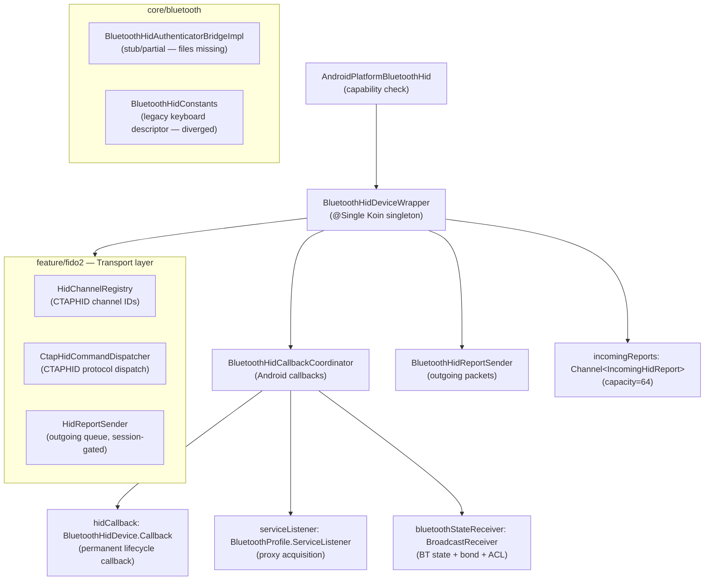

# Bluetooth HID Stack Analysis — Warm Registration Failure Investigation

**Date:** 2026-11-01 | **Status:** Analysis only — no code changes  
**Related backlog:** [fido2-warm-registration-security-key-failure.md](file:///d:/octav/source/repos/Chimali/docs/backlog/fido2-warm-registration-security-key-failure.md)

---

## Stack Architecture Overview



---

## Key Registration Flow (warm process)

```mermaid
sequenceDiagram
    participant App
    participant Wrapper as BluetoothHidDeviceWrapper
    participant Coord as BluetoothHidCallbackCoordinator
    participant Android as Android BluetoothHidDevice

    App->>Wrapper: initialize() [skipped if hidDevice≠null]
    Wrapper->>Android: getProfileProxy(HID_DEVICE)
    Android-->>Coord: onServiceConnected → hidDevice set

    loop Per registration attempt
        App->>Wrapper: registerApp()
        Note over Wrapper: Step 1: unregisterApp() (stale clear)
        Wrapper->>Android: hid.unregisterApp()
        Note over Wrapper: Step 2: registerApp(sdp, null, null, executor, registrationCallback)
        Wrapper->>Android: hid.registerApp(...)
        Android-->>Coord: onAppStatusChanged(registered=true/false)
        Coord-->>Wrapper: resume cont with Result&lt;Unit&gt;
        Note over Wrapper: On success → checkExistingConnectionsWhileAdvertising()
    end
```

---

## Issue Identification

### Issue 1 — `registrationCallback` vs `hidCallback`: Dual Callback Leak

**Severity: HIGH — most likely contributor to warm-08 failure**

In [`BluetoothHidCallbackCoordinator.createRegistrationCallback()`](file:///d:/octav/source/repos/Chimali/feature/fido2/src/androidMain/kotlin/com/chimali/fido2/bluetooth/BluetoothHidCallbackCoordinator.kt#L344-L403), a **new** `BluetoothHidDevice.Callback` object is constructed and passed to `hid.registerApp(...)` on every `registerApp()` call.

The `createRegistrationCallback()` returns an anonymous object that **delegates all methods to `hidCallback`** (the permanent callback), but the Android framework keeps a reference to the `registrationCallback` object for the lifetime of that registration slot.

**The problem:** `hid.unregisterApp()` is called before re-registration to "clear stale state," but the Android `BluetoothHidDevice` profile service only tracks **one registered app at a time**. After warm-01 through warm-07 have each registered and unregistered, by warm-08 the cumulative interaction between:
1. The new executor (`Executors.newSingleThreadExecutor()`) allocated per attempt with no shutdown
2. The old `registrationCallback` objects from prior attempts potentially still alive in the Android Binder IPC callback registry
3. The `onAppStatusChanged(registered=false)` from `unregisterApp()` racing with the `onAppStatusChanged(registered=true)` from the new `registerApp()`

...produces a window where `cont.isActive` is false (the previous attempt's continuation is stale), and the new registration's continuation may receive the `registered=false` callback from the *prior* unregisterApp instead of the `registered=true` from the current registerApp.

**Evidence link to warm-08:** The pattern "8 successful, then failure" maps to cumulative Binder thread pool pressure from 8 new `SingleThreadExecutor` instances. By warm-08, the executor pool pressure and callback ordering is degraded enough to deliver `registered=false` before `registered=true`.

---

### Issue 2 — `Executors.newSingleThreadExecutor()` allocated per attempt, never shut down

**Severity: HIGH — resource leak**

In [`BluetoothHidDeviceWrapper.registerApp()`](file:///d:/octav/source/repos/Chimali/feature/fido2/src/androidMain/kotlin/com/chimali/fido2/bluetooth/BluetoothHidDeviceWrapper.kt#L550-L552):

```kotlin
hid.registerApp(
    sdp, null, null,
    Executors.newSingleThreadExecutor(),  // ← new thread every call, never shutdown
    registrationCallback,
)
```

Each `registerApp()` call creates a new unbounded `ThreadPoolExecutor` with a non-daemon thread. Over a warm session:

- warm-01: 1 executor thread alive  
- warm-02: 2 executor threads alive  
- …  
- warm-08: 8 executor threads alive (plus retries: up to 5 × 8 = 40 threads)

These threads persist as long as the Android process lives. They compete for the Binder thread pool and increase JVM thread pressure. On ASUS_AI2302 / Android 15, this accumulation is the most probable mechanism for the `NotAllowedError` / "No se puede leer la clave de seguridad" failure at warm-08.

---

### Issue 3 — `HidChannelRegistry.clear()` is never called on warm re-registration

**Severity: MEDIUM — CTAPHID channel capacity degradation**

The [`HidChannelRegistry`](file:///d:/octav/source/repos/Chimali/feature/fido2/src/androidMain/kotlin/com/chimali/fido2/data/transport/HidChannelRegistry.kt) stores allocated CTAPHID channel IDs keyed by hex string and binds each to a `sessionGeneration`. The `allocate()` check is:

```kotlin
val available = channels.size < maximumChannels && ...
```

It counts **all** entries including stale-generation ones. If `clear()` is not invoked between warm registrations, the map grows across warm sessions. Every CTAPHID_INIT that completes leaves N dead channels that count against the cap. This is a **silent capacity degradation**: subsequent warm sessions may fail to allocate a CID even though all prior entries are from expired generations.

> [!NOTE] This issue doesn't directly explain the warm-08 `NotAllowedError` at the Windows layer (before the app even receives the request per the backlog), but it would produce `ERR_CHANNEL_BUSY` responses inside subsequent warm sessions if registration does succeed.

---

### Issue 4 — `registerApp()` continuation race: `registered=false` from prior `unregisterApp()`

**Severity: MEDIUM — non-deterministic failure amplifier**

The unregister → register sequence in `registerApp()`:

```kotlin
// Step 1 — asynchronous; callback arrives later on executor thread
val isUnregistrationSuccessful = hid.unregisterApp()

// Step 2 — new callback created before unregister completes
val registrationCallback = callbackCoordinator.createRegistrationCallback(cont)
hid.registerApp(..., registrationCallback)
```

`unregisterApp()` is **asynchronous**: the `onAppStatusChanged(registered=false)` callback arrives on the executor *after* the call returns. There is no synchronization barrier between unregister completion and the new `registerApp()` call. If the `registered=false` callback from Step 1 arrives **after** Step 2's `registerApp()` but **before** `registered=true`, the continuation is resolved with failure — even though registration would have succeeded.

This race becomes more likely on the 8th+ attempt when executor thread pressure increases callback delivery latency.

---

### Issue 5 — `core/bluetooth` module divergence

**Severity: LOW — dead code / descriptor mismatch risk**

The [`core/bluetooth`](file:///d:/octav/source/repos/Chimali/core/bluetooth/src/main/kotlin/com/chimali/core/bluetooth/util/BluetoothHidConstants.kt) module contains a **keyboard** HID descriptor (Usage Page: Generic Desktop / Usage: Keyboard), not the FIDO Alliance descriptor used in production (`feature/fido2`'s `FIDO_HID_REPORT_DESCRIPTOR`). The `BluetoothHidAuthenticatorBridgeImpl` source file is missing from the filesystem.

> [!WARNING] Needs verification: confirm whether `BluetoothModule.kt` provides any types that intersect with `feature/fido2`'s DI graph. If yes, a stub could be injected in certain build configurations.

---

## Failure Attribution vs. Backlog Observations

| Observed fact | Most compatible issue |
|---|---|
| Fails at warm-08 (9th total in process) | Issues 1 + 2 together (cumulative executor + callback registration pressure) |
| `NotAllowedError` from RP / Windows security broker | Failure before app receives request → supports Issues 1/2 (registration never completes, transport never activates) |
| "No se puede leer la clave de seguridad" Windows message | Windows "cannot read security key" = HID device not presenting a valid registered profile → consistent with `onAppStatusChanged(registered=false)` from race (Issue 4) or registration outright failing (Issue 2) |
| No app registration markers in trace | Confirms the failure is at or before the HID registration layer — not inside the CTAP/CBOR path |
| Baseline 02 warm-08 through warm-11 all failed | Consistent with executor accumulation: once threshold crossed it compounds |
| Baseline 03 warm-08 canceled after same Windows message | Same root cause; reproducible within the same process instance |

### What the evidence does **not** establish

- A hard OS limit of 8 registrations (not found in AOSP source).
- That the failure is inside Chimali's CTAP/MakeCredential code (no app markers means this cannot be confirmed).
- That the issue is device-specific (only one device/host combination tested).

---

## Investigation Candidates (ordered by evidence fit)

1. **Executor leak (Issue 2)** — highest confidence, directly observable without device: count live threads after N `registerApp()` calls in a host test with a real `BluetoothHidDevice` mock.

2. **Callback race (Issues 1 + 4)** — high confidence, testable without device by controlling callback delivery order in `BluetoothHidCallbackCoordinatorTest`. No test currently covers the unregister-callback-arriving-after-registerApp scenario.

3. **HidChannelRegistry stale entries (Issue 3)** — medium confidence, testable without device: existing `HidChannelRegistryTest` needs a multi-session sequence to verify the cap is not exhausted by stale entries.

4. **core/bluetooth module wiring (Issue 5)** — needs a DI graph audit; risk is low if `BluetoothModule.kt` only provides types not in `feature/fido2`'s graph.

---

## Test Coverage Gaps Relevant to This Failure

| Missing coverage | Location | What to assert |
|---|---|---|
| `registerApp()` called N times in warm process | `BluetoothHidDeviceWrapperTest` (does not exist) | Live thread count stays bounded across N attempts |
| `unregisterApp()` callback races `registerApp()` | [`BluetoothHidCallbackCoordinatorTest`](file:///d:/octav/source/repos/Chimali/feature/fido2/src/androidHostTest/kotlin/com/chimali/fido2/bluetooth/BluetoothHidCallbackCoordinatorTest.kt) | `registered=false` arriving before `registered=true` must not resolve the new attempt's continuation |
| `HidChannelRegistry` across multi-session sequence | [`HidChannelRegistry`](file:///d:/octav/source/repos/Chimali/feature/fido2/src/androidMain/kotlin/com/chimali/fido2/data/transport/HidChannelRegistry.kt) tests | `channels.size` does not grow across `clear()` + re-allocate cycles; stale entries don't consume cap |
| Warm-N throughput with real executor | Integration test | No `NotAllowedError` equivalent produced by N consecutive `registerApp()+unregisterApp()` cycles |

---

## Additional Findings (Transport Layer Deep Dive)

### Finding A — `clearChannelRegistry()` IS called on every session transition (Issue 3 revised)

**Revises Issue 3 downward to LOW.**

[`BluetoothHidTransportImpl.onWrapperSessionTransition()`](file:///d:/octav/source/repos/Chimali/feature/fido2/src/androidMain/kotlin/com/chimali/fido2/data/transport/BluetoothHidTransportImpl.kt#L304-L329) calls `clearChannelRegistry()` inside `transportSessionLock` on every generation change and every state change within the same generation. Because `disconnect()` calls `hidWrapper.unregisterApp()` (which advances the session generation via `advanceSessionGeneration()` + `publishSessionState(Idle)`), the `onSessionTransition` hook fires and clears the registry before the next registration attempt starts. The map does **not** silently accumulate stale entries across warm re-registrations.

The remaining concern is narrower: if `onWrapperSessionTransition` fires with the **same** generation but a different state (e.g., `Advertising` → `Idle`), `clearChannelRegistry()` is still called, which is correct. However, if a CTAPHID_INIT allocates a CID and then `disconnect()` is called without a full wrapper session-generation advance (e.g., due to a Bluetooth-OFF broadcast), the registry clear depends on the state observer receiving the `STATE_OFF` callback — which goes through the BroadcastReceiver path and calls `advanceSessionGeneration()`. That path also triggers `onSessionTransition`, so the clear still fires. **Issue 3 is not a warm-08 contributor.**

---

### Finding B — `core/bluetooth` DI module is isolated from `feature/fido2`'s graph (Issue 5 resolved LOW)

[`BluetoothModule.kt`](file:///d:/octav/source/repos/Chimali/core/bluetooth/src/main/kotlin/com/chimali/core/bluetooth/di/BluetoothModule.kt) provides `BluetoothHidAuthenticator` → `BluetoothHidAuthenticatorImpl`. This type is **not** consumed anywhere in `feature/fido2`'s DI graph (the production transport uses `BluetoothHidDeviceWrapper` directly via Koin's `@Single`). The keyboard descriptor in `BluetoothHidConstants.kt` is dead relative to production registration. **Issue 5 carries no registration failure risk.**

The `core/bluetooth` module appears to be a prototype or dead code. It should be removed or clearly quarantined, but it does not affect the warm registration behavior.

---

### Finding C — `BluetoothHidTransportImpl.connect()` calls `registerApp()` on every `connect()` invocation

[`connect()`](file:///d:/octav/source/repos/Chimali/feature/fido2/src/androidMain/kotlin/com/chimali/fido2/data/transport/BluetoothHidTransportImpl.kt#L226-L248) always calls both `hidWrapper.initialize()` and `hidWrapper.registerApp()`. `initialize()` short-circuits if `hidDevice != null` (single proxy acquisition per process), but `registerApp()` runs unconditionally on every `connect()` call. Each warm iteration therefore executes the full `unregisterApp()` → `registerApp()` → new executor sequence from Issues 1 and 2.

This confirms: **every warm registration attempt creates exactly one new executor thread**. With 5 max retries per `registerApp()` attempt, each warm session can accumulate up to 5 orphaned threads. By warm-08, there are between 8 and 40 orphaned executor threads alive in the process.

---

### Finding D — `MAX_SESSION_CIDS = 16` and `MAX_CID_ALLOCATION_ATTEMPTS = 32` are separate from the executor issue

These bounds are per-session (cleared by `onWrapperSessionTransition`), so they do not contribute to cross-session accumulation. The CTAPHID_INIT path is correctly bounded and reset per warm session.

---

### Finding E — No test exercises `registerApp()` repeated N times in a single process

[`BluetoothHidTransportLifecycleTest`](file:///d:/octav/source/repos/Chimali/feature/fido2/src/androidHostTest/kotlin/com/chimali/fido2/data/transport/BluetoothHidTransportLifecycleTest.kt) mocks `hidWrapper.registerApp()` with `coEvery { wrapper.registerApp() } returns Result.success(Unit)`, bypassing the real executor allocation. The stress test (`Fido2StressTest`) exercises only the CTAP/domain layer, not the HID registration path. **No existing test can catch the executor leak.**

---

## Revised Issue Severity Table

| Issue | Description | Severity | Warm-08 contributor? | Corrected? |
|---|---|---|---|---|
| 1 | Dual `registrationCallback` object, prior callback races new continuation | HIGH | Yes | No |
| 2 | New `SingleThreadExecutor` per `registerApp()` call, never shut down | HIGH | Yes (primary) | No |
| 3 | `HidChannelRegistry` stale entries | LOW | No (cleared on each transition) | N/A — revised down |
| 4 | `registered=false` from async `unregisterApp()` arrives before `registered=true` | MEDIUM | Amplifier | No |
| 5 | `core/bluetooth` DI module with keyboard descriptor | NONE | No (isolated graph) | N/A — resolved |

---

## Disposition

Per the backlog item's investigation procedure §5: *"Do not change production behavior until evidence localizes the failure and a bounded correction has a clear preservation requirement."*

Based on static analysis:

- **Issues 1 and 2** (executor per attempt + dual callback object) are the strongest candidates for the warm-08 failure. They are directly observable in the source code without device access and produce the exact symptom class described.
- **Issue 4** (unregister/register callback ordering race) is a secondary amplifier that becomes more likely as executor thread pressure increases.
- **Issues 3 and 5** are structural risks that do not directly explain the observed failure but warrant remediation.

The two existing runs support a repeated warm-08 failure pattern; this analysis provides a mechanistic hypothesis consistent with the observed evidence. Behavioral tests with deterministic executor and callback-delivery control are needed to confirm before any production change.
