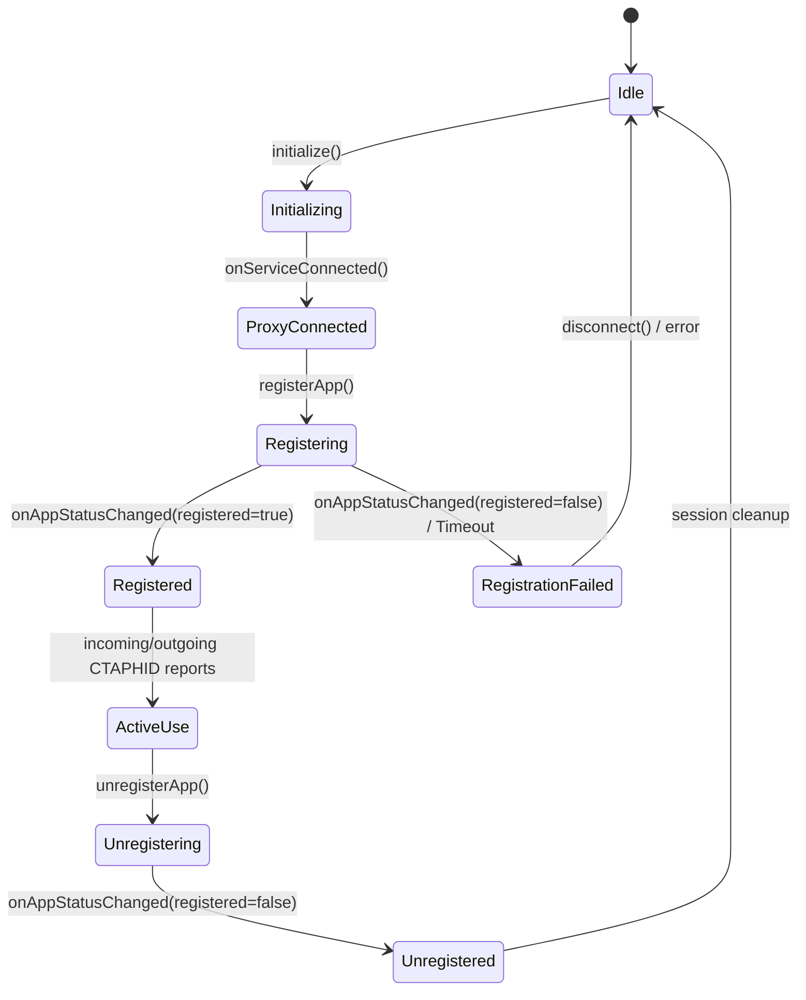
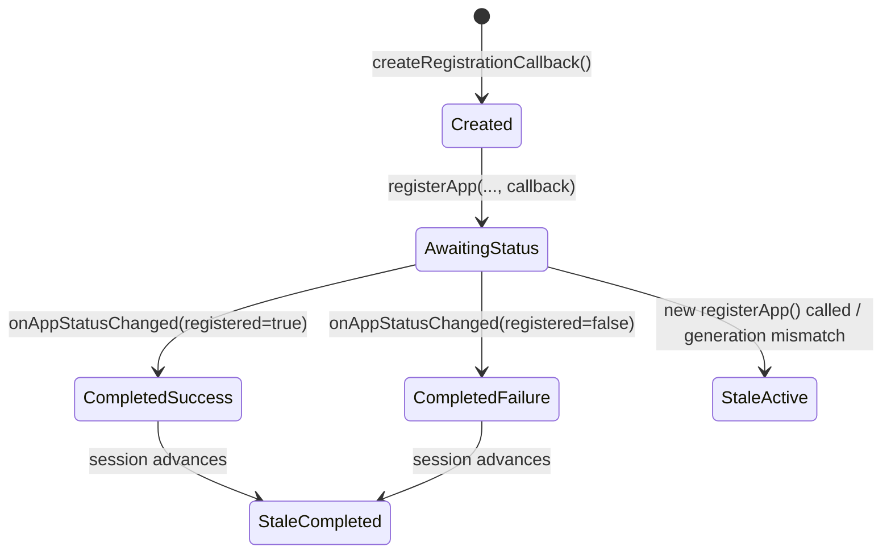

# Data Model: Bluetooth HID Warm Registration Investigation

**Feature Branch**: `063-hid-warm-reg-failure` | **Date**: 2026-11-02  
**Spec Reference**: [spec.md](spec.md)

This document formalizes the runtime entities, states, and lifecycle transitions involved in the Bluetooth HID registration path under repeated warm executions.

---

## Entities & Lifecycles

### 1. Warm Registration Session

Represents a single full registration-to-deregistration cycle executed within an uninterrupted Android OS process lifetime.

**Attributes:**
- `processId`: OS Process ID (constant across warm sessions).
- `warmAttemptIndex`: Monotonic 1-based index of warm attempts in this process (1..N).
- `sessionGeneration`: Integer token incremented on each proxy acquisition or major lifecycle transition.
- `registrationState`: Current state (`Idle`, `Registering`, `Registered`, `Unregistering`).

**Invariants:**
- At most one `WarmRegistrationSession` may be in `Registering` or `Registered` state at any time.
- Completing a warm session must leave system resources (threads, memory allocations) in the baseline state ($O(1)$ scaling).

---

### 2. Executor Lease

Represents the lifecycle of the `java.util.concurrent.ExecutorService` instantiated to service `BluetoothHidDevice.Callback` Binder IPC invocations.

**Attributes:**
- `executorId`: Unique identifier for the instance.
- `sessionGeneration`: Associated session generation.
- `threadName`: Thread name identifier.
- `state`: `Active`, `ShuttingDown`, `Terminated`, `Orphaned` (leak).

**Invariants & Bounds:**
- **Remediated / Target Bound**: Every captured executor $E_j$ ($j=1..M$) must be terminated upon completion of its cycle by production lifecycle logic ($R_{\text{final}} = 0$).
- **Investigation / Characterization Target**: In the uncorrected codebase, production does not call `shutdown()`. For $N$ wrapper cycles, let $M$ be the total captured executor instances across all attempts and retries ($M \ge N$). After each cycle $c$, record the pre-cleanup retained count $R_c$ across every executor captured through that cycle. Perform a fresh final evaluation across all $M$ instances. A positive $R_{\text{final}}$ records retention; growth of $R_c$ with full retention $R_{\text{final}} = M$ characterizes executor accumulation under the harness. $R_{\text{final}} = 0$ is the target healthy bound.

---

### 3. Registration Callback Binding

Represents the `BluetoothHidDevice.Callback` object registered with the Android Bluetooth profile service.

**Attributes:**
- `callbackInstanceId`: Identity hash of the callback instance.
- `sessionGeneration`: The session generation during which it was created.
- `targetContinuation`: Active `CancellableContinuation<Result<Unit>>` captured in this callback's closure.
- `isCurrent`: Boolean flag indicating if this callback instance matches the active registration lease.

**State Machine:**

**Invariants & Observed Model:**
- *Target Desired Isolation*: An obsolete callback (`StaleActive` or `StaleCompleted`) receiving an event must not disrupt the active continuation or session state of a newer registration session.
- *Production Model*: In the existing implementation, callbacks do not discard stale events via generation tagging; instead, an old callback delegates to `hidCallback`, which advances `sessionGeneration` and publishes `Idle`. The investigation characterizes whether this shared-state transition disrupts active registrations in practice.

---

### 4. CTAPHID Channel Allocation Entry

Represents an allocated 32-bit CTAPHID channel identifier inside `HidChannelRegistry`.

**Attributes:**
- `channelId`: 4-byte CID (e.g. `0x00000001` or broadcast `0xFFFFFFFF`).
- `allocatedAtEpochMs`: Monotonic timestamp of CID allocation.
- `sessionGeneration`: Generation of the session in which the channel was granted.

**Invariants:**
- When `sessionGeneration` advances, all entries in `HidChannelRegistry` MUST be cleared before new allocations can occur.
- Count of active channels cannot exceed `maximumChannels` (16).
